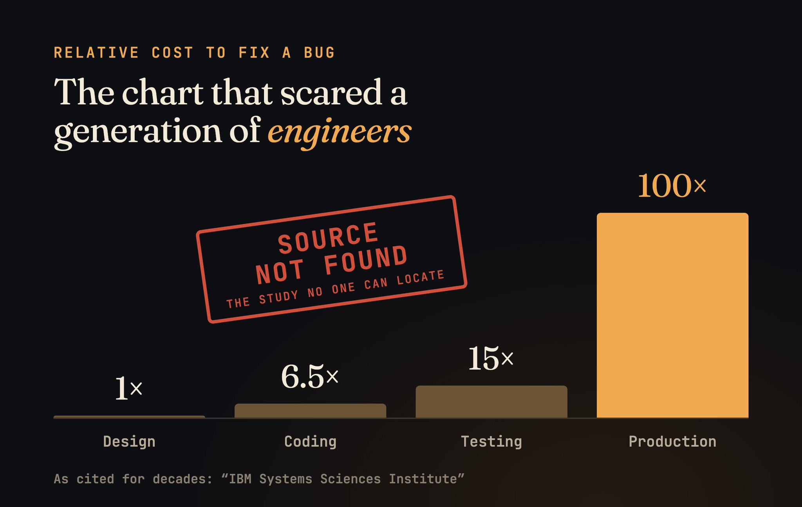
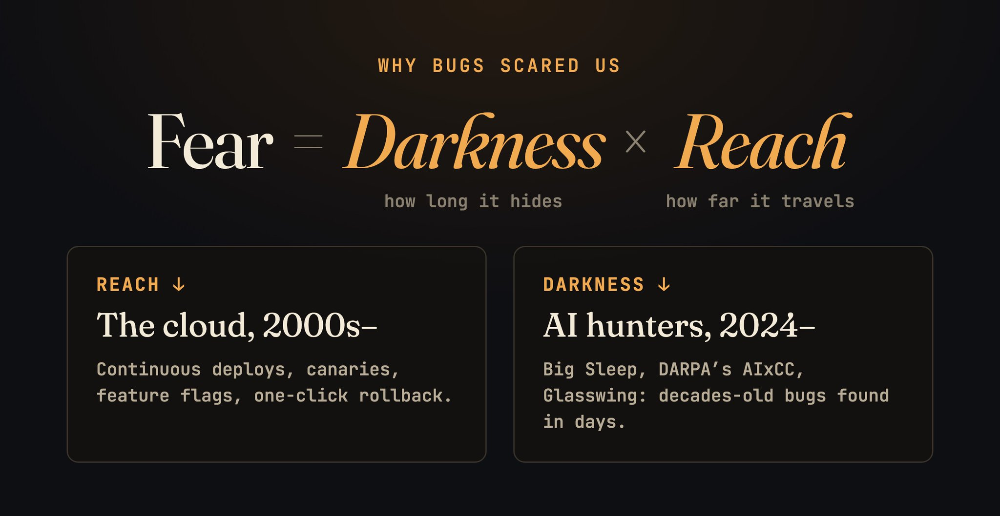

*For seventy years, the bug was the thing software feared most. That fear is quietly dying, and something else is taking its place.*

At 3:45 in the afternoon on September 9, 1947, the Harvard Mark II started acting up. Grace Hopper’s team opened Panel F, traced the fault to Relay #70, and found a moth stuck in the contacts.

They pulled it out, taped it into the logbook, and wrote one line underneath:

> First actual case of bug being found.

It was a joke. Engineers had called glitches “bugs” since Edison’s day. The moth just made it literal. That page still exists, moth and all, at the Smithsonian.

")

What came after was not a joke. Over the next seventy years, the bug became the most feared thing in our industry.

I think that era is ending. Not because we stopped writing bugs. We write more than ever. It’s ending because the bug is no longer the thing worth fearing.

## When a bug could end you

Every engineer knows at least one story from the monster years.

In the mid-1980s, a radiation therapy machine called the Therac-25 gave six patients massive overdoses. Several died. In one case, an experienced operator mistyped one letter, fixed it in seconds with the cursor key, and started treatment. The screen said “Malfunction 54.” She pressed P to proceed, like she had many times before. Underneath was a race condition that only showed up when someone typed fast.

In 1996, the first Ariane 5 broke apart less than 40 seconds after liftoff. A 64-bit number got squeezed into a 16-bit slot, in code reused from Ariane 4 that wasn’t even needed after launch. Roughly $370 million, gone. Three years later, NASA lost a Mars orbiter because one team’s software spoke pound-force seconds and the other’s expected newton-seconds.

In 2012, Knight Capital rolled out new trading code to seven of its eight servers. The eighth still carried dead code from years earlier, and a reused flag woke it up. In 45 minutes it fired over four million orders and lost more than $460 million. Within a year, Knight was gone as an independent company.

In 2014, we learned Heartbleed had been sitting in OpenSSL for two years, quietly leaking memory from around half a million secure servers.

Every story taught the same lesson. A bug isn’t just a mistake. It’s a monster under the floorboards.

## We built an industry around the fear

So we organized our whole craft around it.

Waterfall phases. Sign-off sheets. QA departments. Change advisory boards. Holiday code freezes. “Never deploy on a Friday.” Software shipped on discs, and the final build was literally called the gold master. Once it went to the factory, every bug on it was permanent. Shipping was an act of faith.

Hanging over all of it was one chart.

You’ve seen it. A bug costs 1x to fix in design, 6.5x in coding, 15x in testing, and 100x in production.

Bugs really were expensive back then. But the most famous number about them was, fittingly, a ghost story.

## The first crack: fixing got cheap

The web killed the gold master. If you could ship any time, you could fix any time.

By 2011, Amazon was deploying to production every 11.6 seconds on average. Feature flags let teams switch code off without a redeploy. Canary releases tried new code on a sliver of users first. Rollback became a button. A production bug went from a product recall to a revert.

That took away half of the monster’s power: its reach. It didn’t touch the other half. Bugs could still hide.

## The second crack: finding got cheap

For decades, finding bugs meant a smart, tired human reading code at 2 a.m. Fuzzers helped, but they’re blunt. They find crashes, not meaning.

Then the hunters got smart, fast.

- **Nov 2024:** Google’s Big Sleep agent found an exploitable bug in SQLite before it ever reached a release. Same month, AI-written fuzz targets surfaced an OpenSSL flaw that had likely been hiding for two decades.
- **Aug 2025:** At DARPA’s AI Cyber Challenge, autonomous systems combed 54 million lines of code and found 18 real vulnerabilities nobody had planted. Average time to patch: 45 minutes. Cost per task: about $152.
- **2026:** Anthropic reported Claude finding 500+ high-severity bugs in open source. Then its Mythos Preview model dug up a 27-year-old bug in OpenBSD, and Project Glasswing partners using it reported over 10,000 high or critical vulnerabilities in about a month. Mozilla alone shipped 271 fixes in a single Firefox release.

Security bugs in software running on billions of devices, filed like everyday tickets. They still matter. There are just too many of them to treat each one like a monster.

## The bug was never the monster

Go back to the horror stories and look closer.

Ariane 5’s code worked perfectly, on Ariane 4. Knight’s disaster was an old function nobody deleted and a deploy that missed one server. The Mars orbiter was two teams that never compared units. CrowdStrike, the biggest IT outage in history, came down to a template that defined 21 input fields while the code feeding it supplied 20.

None of these were genius-level bugs. Most were the kind of mistake anyone makes on a Tuesday.

What made them monsters was everything around them. Heartbleed was dangerous because it hid for two years. CrowdStrike was catastrophic because one file reached 8.5 million Windows machines before anyone could stop it. The moth was tiny. The shadow it threw was enormous.

Our fear of bugs was always fear of two things. 

**Darkness:** how long a mistake can hide. 

**Reach:** how far it travels before someone notices. 

The cloud went after reach. AI is now going after darkness. That’s why the monster is shrinking.

## So what deserves the fear now?

Not the moth. The lamp, and who’s holding it.

**The fix queue.** Finding is now nearly free. Fixing still moves at human speed. By Glasswing’s first update, 530 high or critical bugs had been disclosed to open-source maintainers, and 75 were patched. A bug nobody has time to fix is just a known bug waiting for someone else to use it.

**The other side’s lamp.** Attackers have the same tools. In July 2025, Google said Big Sleep helped stop a SQLite flaw that, until then, only threat actors knew about. It’s machine against machine now, and the gap between found and fixed is where the damage happens.

**Code nobody understands.** Google says about three-quarters of its new code is now AI-generated. Most bugs in that code will be found and fixed. What can’t be patched is not knowing why your system does what it does. The hardest defect to catch is software that works perfectly while doing the wrong thing.

## Back to the moth

The Harvard team didn’t panic. They taped the moth into the book, made a joke, and got the machine running again.

That’s the healthy relationship with a bug. Notice it. Write it down. Fix it. Move on. For seventy years we couldn’t afford that calm, because one bug could cost a rocket, a company, or a life.

Now, almost, we can.

**The moth is just a moth again. Watch the shadow.**

## Sources

- [Harvard Mark II logbook, U.S. Navy photo NH 96566-KN](https://commons.wikimedia.org/wiki/File:First_Computer_Bug,_1947.jpg)
- [Leveson & Turner, An Investigation of the Therac-25 Accidents (1993)](https://ftp.eecs.berkeley.edu/~bh/61a-pages/Volume2/Therac-25.pdf)
- [SEC on Knight Capital (2013)](https://www.sec.gov/news/digest/2013/dig101613.htm)
- [The Register on the missing “100x” study (2021)](https://www.theregister.com/2021/07/22/bugs_expense_bs/)
- [CrowdStrike Channel File 291 root cause analysis](https://www.crowdstrike.com/wp-content/uploads/2024/08/Channel-File-291-Incident-Root-Cause-Analysis-08.06.2024.pdf)
- [Google Project Zero, From Naptime to Big Sleep](https://projectzero.google/2024/10/from-naptime-to-big-sleep.html)
- [Google Security Blog on AI-powered OSS-Fuzz](https://security.googleblog.com/2024/11/leveling-up-fuzzing-finding-more.html)
- [DARPA AIxCC final results](https://www.darpa.mil/news/2025/aixcc-results)
- [Anthropic on Claude Opus 4.6 zero-days](https://www.anthropic.com/research/zero-days)
- [Anthropic, Project Glasswing initial update](https://www.anthropic.com/research/glasswing-initial-update)
- [Daniel Stenberg, The end of the curl bug bounty](https://daniel.haxx.se/blog/2026/01/26/the-end-of-the-curl-bug-bounty/)
- [Daniel Stenberg, Do minor curl vulnerabilities in the open](https://daniel.haxx.se/blog/2026/10/20/do-minor-curl-vulnerabilities-in-the-open/)
- [Google on Big Sleep foiling an exploit (July 2025)](https://blog.google/innovation-and-ai/technology/safety-security/cybersecurity-updates-summer-2025/)
- [Semafor on Google’s AI-generated code share (April 2026)](https://www.semafor.com/article/04/24/2026/google-ceo-says-75-of-companys-new-code-is-ai-generated)
