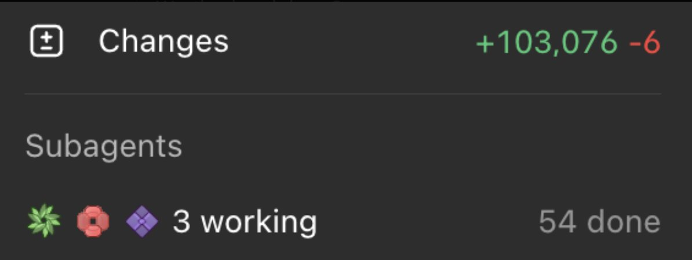

The setup behind my Luna, Terra, and Sol agents. No custom orchestration framework required.

That was the subagent counter in a recent Codex session I shared on [X.](https://x.com/fenillramoliya/status/2109553006140400058)

I didn't create 50+ different kinds of agents. I configured three roles, and let the parent Codex agent decide when it needed them.

I wanted the main Codex agent to own the task, make the decisions, and pull in the right kind of help when it made sense. The subagents would do their work in separate threads and bring back findings, code changes, or reviews.

My setup comes down to three custom agent files, one default configuration, and a section in AGENTS.md.

## 1. Give the agents different jobs

Codex supports custom subagents as TOML files. I keep mine under ~/.codex/agents/, so they are available across projects. You can also put them in a repository's .codex/agents/ directory. [1]

```text
~/.codex/
  config.toml
  AGENTS.md
  agents/
    luna.toml
    terra.toml
    sol.toml
```

The roles are deliberately different:

- **Luna** explores. It finds code paths, references, docs, logs, and other evidence.
- **Terra** builds. It handles normal implementation, debugging, refactoring, and tests.
- **Sol** thinks through harder problems. Architecture, difficult root causes, concurrency, and decisions with real tradeoffs.

This is not about making Sol do everything because it is the stronger model. Much of an engineering task is finding things, checking assumptions, or making straightforward edits. Those shouldn't automatically require the most expensive reasoning path.

You don't need giant instructions for each worker. These are compact, copyable versions of the roles in my setup.

### luna.toml

```toml
name = "luna"
description = """Focused worker for codebase exploration, finding references, documentation research, log inspection, information gathering, and concise summaries. Prefer for bounded tasks without complex engineering decisions."""

model = "gpt-6-luna"
model_reasoning_effort = "max"

developer_instructions = """
Work on the task delegated by the parent agent. Stay within scope.
Prefer targeted searches and evidence from code or documentation over guesses.
Return relevant file paths, symbols, and concise findings.
Make code changes only when explicitly assigned.
Report blockers and checks performed.
"""
```

### terra.toml

```toml
name = "terra"
description = """General-purpose engineering worker for implementation, debugging, refactoring, tests, code review, and multi-file work that needs practical engineering judgment."""

model = "gpt-5.6-terra"
model_reasoning_effort = "high"

developer_instructions = """
Work on the engineering task delegated by the parent agent.
Inspect existing code and follow project conventions first.
Make the smallest correct, maintainable change; avoid unrelated refactors.
Prefer tests of real behavior, mocking only external boundaries when practical.
Run focused validation and report changed files, results, and risks.
"""
```

### sol.toml

```toml
name = "sol"
description = """Deep reasoning worker for complex root-cause debugging, cross-system architecture, concurrency, migrations, critical reviews, and decisions with significant tradeoffs."""

model = "gpt-6.1-sol"
model_reasoning_effort = "high"

developer_instructions = """
Work on the complex task delegated by the parent agent.
Inspect relevant code, contracts, and constraints before deciding.
Separate verified findings from assumptions and examine failure modes.
Favor the simplest robust solution over speculative abstractions.
Edit only if implementation is assigned; otherwise return analysis.
Report evidence, tradeoffs, verification, and unresolved risks.
"""
```

The **description** helps the parent understand **when** a role fits. The **developer_instructions** tell the spawned agent how to work. The **model** and **model_reasoning_effort** select the model for that role. [1]

These model names and reasoning settings are my personal choices, not a requirement. Pick the models available in your Codex account. I also have Luna on ***max***; if I were optimizing strictly for fast, cheap exploration, I'd test ***high*** against it.

## 2. Set the default separately

In ~/.codex/config.toml, you can set a fallback like this:

```toml
[agents]
enabled = true
max_concurrent_threads_per_session = 6
default_subagent_model = "gpt-5.6-terra"
default_subagent_reasoning_effort = "high"
```

This answers a common question: what if Codex spawns a subagent without choosing one of my named roles?

It has a default. In this example, that's Terra on high reasoning. But a named custom agent with its own model and model_reasoning_effort uses those values instead. The default is a fallback, not an instruction to replace Luna or Sol. [1]



The concurrency setting **caps open spawned-agent threads**, not the total number of agents a task may use over time. My screenshot showed cumulative runs, not 54 agents all executing in parallel. [1]

## 3. Tell the parent when to delegate

The TOMLs define the workers. They don't, by themselves, explain my preferred way of coordinating them.

That is what I add to my global **~/.codex/AGENTS.md:**

```markdown
## Subagent orchestration

Use custom subagents when delegation improves speed, cost,
context isolation, or parallelism. Do not delegate unnecessarily.

- `luna`: Focused exploration, search, research, and summaries.
- `terra`: Implementation, debugging, refactoring, and tests.
- `sol`: Complex root-cause analysis, architecture, and tradeoffs.

Choose the lowest-cost capable agent for the task.
When a user explicitly requests a named agent, use that agent.

For larger tasks, the primary agent is the orchestrator:
- Split independent work into clearly scoped tasks.
- Run independent investigations in parallel when useful.
- Avoid overlapping code edits and duplicate investigations.
- Wait for findings needed by subsequent work.
- Integrate results, validate the outcome, and make final decisions.
```

The distinction matters: **AGENTS.md** guides the parent agent's delegation decisions. It isn't a hard-coded routing engine. Codex reads applicable AGENTS.md instructions when a run starts, and local Codex can delegate when those instructions request it. [1][2]

## 4. What orchestration looks like in practice

Imagine I'm debugging a flaky background job.

```text
You: "Find and fix this flaky job"
                  |
             Main Codex
                  |
         +--------+---------+
         |                  |
       Luna                Sol
  Find code paths,     Reason about the
  logs, references     tricky failure mode
         |                  |
         +--------+---------+
                  |
                Terra
         Implement a focused fix
           and run the tests
                  |
             Main Codex
       Review, integrate, report
```

This is an example, not a claim about the specific task in my screenshot. The point is that the parent has a job beyond spawning more agents: **decide what work is independent, what needs deeper thought, and what must wait.**

There is also a practical reason to keep exploration separate. Search output, stack traces, test logs, and intermediate dead ends can fill the main context with noise. Subagents let the parent receive a compact result rather than every step along the way. [1]

A few things I try to keep in mind:

- Make roles distinct enough that the parent has a reason to choose one over another.
- Parallelize independent investigation more readily than simultaneous writes to the same files.
- Let the parent own final integration and validation.
- Remember that subagents consume tokens too. Delegation should earn its overhead. [1]

I don't want Codex to spawn a swarm for a one-line fix. I want it to recognize when a quick Luna pass is enough, when Terra should build, and when the problem really deserves Sol.

The config is the easy part. **Getting the parent to delegate with judgment is the interesting part.**

If you're experimenting with a similar setup, I'd be curious how you decide when to escalate from a fast worker to a deeper reasoning agent.

---

## References

1. OpenAI, [Codex subagents documentation](https://developers.openai.com/codex/subagents).
2. OpenAI, [Custom instructions with AGENTS.md](https://developers.openai.com/codex/guides/agents-md).
