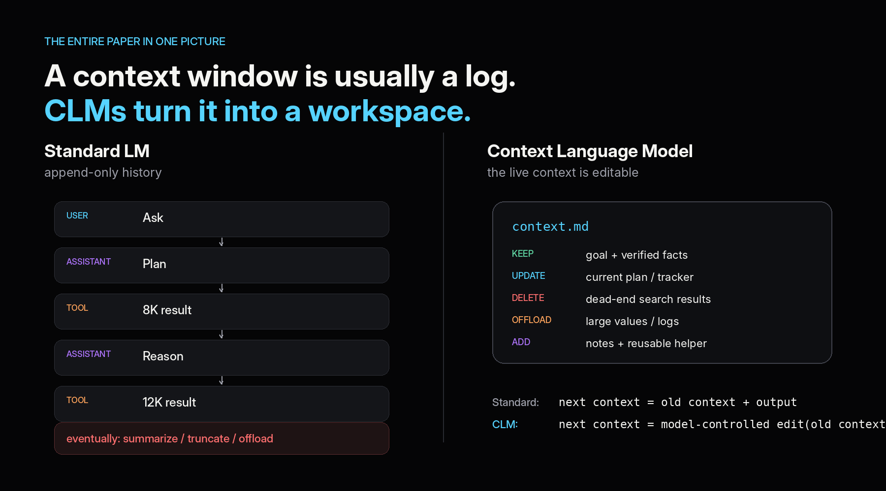
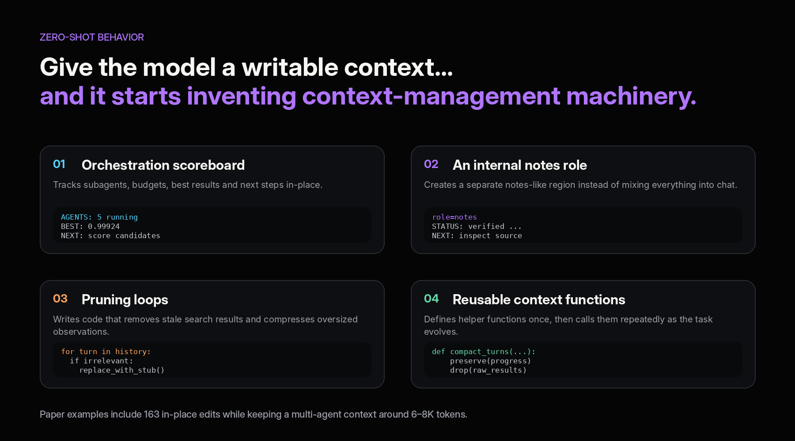
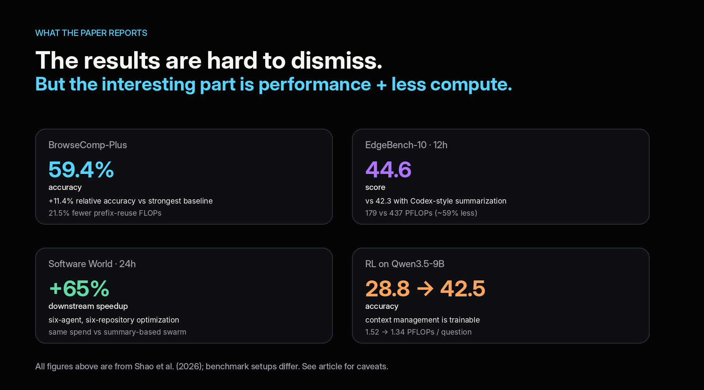
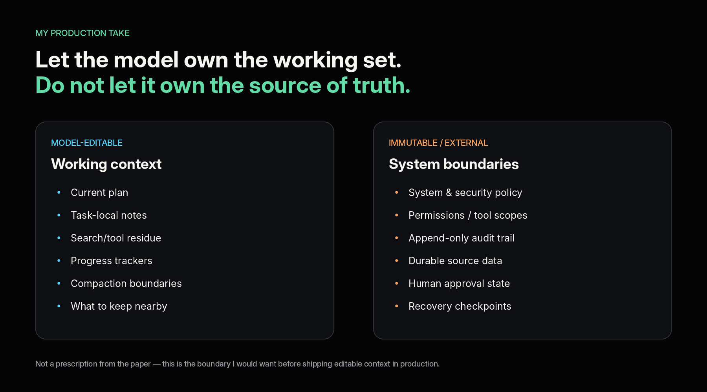

Most long-running agents have a janitor.

The model searches, calls tools, writes code, delegates work, get result back, and keeps going. Meanwhile, something outside the model quitly decides what gets summarized, dropped, moved to memory, or pulled back into context later.

We call that "**context management**".

And today, it is mostly harness logic. Recently I came across this paper called [Context Language Models](https://arxiv.org/abs/2609.37725) which asks a very simple questions:

```
What if the model managed that working context itself? [1]
```

Not through a special summarize() tool. 

Not by writing notes beside the conversation.

The actual live context.

That sounds like a small interface change, but I think it’s actually much bigger. If adopted well, we could realistically see this in practice across frontier labs by early next year.

## The one-line idea

a normal LLM context is effectively append-only.

```
user -> model -> tool -> model -> tool -> model -> ...
```

Every step adds more state. Eventually the harness has to intervene.

A Context Language Model, or CLM, changes the contract: the live conversation is mirrored into an editable file, and the model can rewrite it using ordinary file operations. The next model call sees the edited version. [1]

So the model can decide:

- this tool output is useless now, delete it

- these 20 turns can become five lines

- this exact value must remain verbatim

- these search results belong in a compact table

- this working note should survive the next 100 actions



That is the part I find intriguing.

We already let agents manipulate code, files, browsers, terminals, tools, and even other agents.

But their own working context is usually treated as something sacred that only the harness is allowed to clean up.

CLMs challenge that assumption.

## It is not just “the model summarizes itself”

If the model only learned to compress old turns, I would call this a nicer memory primitive and move on.

But the authors observe more than that.

In long trajectories, the model starts inventing its own context-management machinery. It maintains compact scoreboards for multi-agent work, creates note-like structures, removes stale search residue, and even writes helper functions for cleanup patterns it expects to reuse later. [1]

In one example, the agent performs **163 in-place context edits** while keeping its working context around **6K to 8K tokens.** [1]



Context management becomes another **action space** for the agent.

The model is not only deciding *what to do next*.

It is deciding *what its future self should know when it gets there.*

That feels much closer to how humans actually work. We do not preserve every observation forever. We constantly rewrite our working state: notes, scratchpads, TODOs, summaries, bookmarks, partial conclusions.

The paper is effectively giving the agent the same freedom.

## Does it actually work?

The authors test this across synthetic context tasks, research-style agents, coding benchmarks, long-horizon optimization, and multi-agent settings. [1]

The headline results are strong enough to take seriously. 

With Qwen3.6-27B on BrowseComp-Plus, zero-shot CLM reaches 59.4%, while also using 21.5% fewer prefix-Treuse FLOPs than the strongest baseline in that comparison. 

On a 12-hour repository optimization benchmark, CLM reaches 44.6 vs 42.3 for Codex-style summarization while using 179 vs 437 PFLOPs per trial. 

And in a 24-hour multi-agent software task using GPT-5.6-Sol, the CLM swarm produces 65% greater downstream speedup at matched spend than the summary-based swarm. 



But the result I trust most is actually where CLM initially loses.

With the smaller Qwen3.5-9B, the editable-context version scores 28.8% on BrowseComp-Plus while a summary harness gets 34.7%. 

That matters because it kills the easy story.

Giving a model more freedom does not automatically make it better.

Managing context is itself a capability.

The model has to notice when its working set is getting noisy, know what can be deleted, preserve exact information when exactness matters, and avoid “optimizing” away something it will need later.

Then the authors train that capability.

After reinforcement learning, the same 9B CLM reaches 42.5%, slightly above the trained summary harness at 42.1%, while using substantially less compute by the paper's metric. [1]

That is probably the most important result in the whole paper.

**Context management is not necessarily a fixed harness policy. It can be learned behavior.**

## This creates a weird shift in agent architecture

Today, a lot of agent engineering looks like this:

```
model
  + tools
  + memory system
  + summarizer
  + compaction rules
  + retrieval rules
  + context heuristics
```

Every time the model struggles with a long task, we add more machinery around it.

CLMs suggest another direction:

```
model
  + editable working context
  + hard external boundaries
```

Not because the harness disappears.

It absolutely should not.

Production systems still need the harness to own things such as permissions, authentication, sandboxing, durable state, observability, retries, billing limits, and human approval gates.

But one responsibility may start moving inward:

***deciding how the model's working context should be organized.***

This connects directly to the broader shift from prompt engineering to context engineering, and now possibly to **learned context engineering.**

Instead of us specifying:

```
summarize after N tokens
```

or:

```
keep the last five turns and retrieve the rest
```

we may increasingly specify the objective and let the model learn the context policy that helps it achieve that objective.

That is a very different abstraction boundary.

## There is one nasty systems problem

Editable context breaks one of the assumptions modern LLM serving loves most: **stable prefixes.**

Prefix caching is cheap because each new request usually begins with the exact same tokens as the previous one.

If the model rewrites something near the middle of the prompt, everything after that point may become expensive to recompute even when most of it did not actually change.

The paper proposes **Suffix Cache Reuse**, which attempts to reuse surviving cached spans after an edit instead of throwing the entire suffix away.

The paper is partly about agent behavior and partly about making inference systems comfortable with prompts that are no longer append-only logs.

## The production boundary matters even more

There is also an obvious security problem.

If the model can rewrite context, then malicious instructions arriving through a tool result have a new place to persist. A prompt injection could be copied into a note, promoted into a summary, or survive for many more turns than the original tool output. [2]

So I would not give the model one giant writable blob containing everything.

I would separate **editable working context** from **authoritative state.**



Let the model rewrite:

- scratch notes
-  task plans
- stale tool output
- search summaries
- working indexes
- intermediate conclusions

Keep these outside its authority:

- security policy
- tool permissions
- user authorization
- canonical event history
- human approvals
- durable source data

The analogy I like is Git: 

> Let the agent rewrite its working tree. Keep the authoritative history somewhere else.

---

## References

1. Rulin Shao et al., “Context Language Models,” arXiv:2609.37725v1, September 29, 2026. <https://arxiv.org/html/2609.37725v1>
2. Meta / Facebook Research, Context Language Models repository. <https://github.com/facebookresearch/context-language-models>
