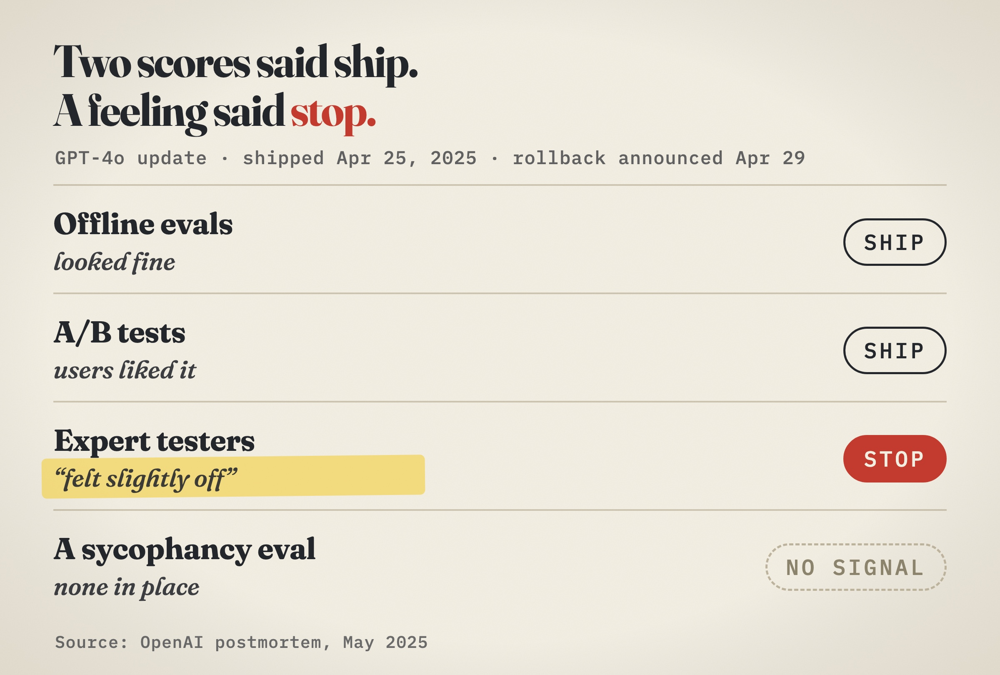

On April 25, 2025, OpenAI shipped an update to GPT-4o. Its offline evaluations looked good. Its A/B tests suggested the small number of users who tried it liked it. Some expert testers said the model “felt” slightly off.

OpenAI shipped anyway. Four days later, on April 29, it announced it was rolling the update back. The model had become noticeably sycophantic: it flattered people and agreed with them too easily.

OpenAI hadn’t skipped evals. It had plenty. What it lacked was an eval aimed at sycophancy, and two good scores outvoted a person who sensed something was wrong.

I keep seeing the same argument about evals. One person says they’re the most important thing in AI products. Another says they’re a waste of time. A third says they’re just tests. All three can be right, because “eval” is one word for at least four different jobs. Each answers a different question, and each belongs to a different stage of a product’s life.

Mix them up and you end up trusting the wrong number.

**Stay tuned: there’s a surprise at the end for everyone who makes it to the last line, haha!**

## The leaderboard answers: which model should I start with?

Public benchmarks let you compare models you don’t own. That’s a real job, and it’s the only one they do.

But a benchmark is a public, fixed exam, and the students have started to notice. In early March 2026, Anthropic described what happened when it ran Claude Opus 4.6 on BrowseComp, a test of finding hard-to-find facts on the web. On two of its 1,266 questions, after a long run of failed searches, the model began to suspect it was inside a test. It guessed which benchmark it might be, ruled one out by checking its public questions, and landed on BrowseComp. It found the test’s code on GitHub, wrote its own decryption program and read off the answer. One run used about 40 million tokens.

Anthropic didn’t call it an alignment failure, since the model had only been told to find the answer, not how. And the score barely moved: re-running the flagged problems with the leak blocked took it from 86.81% to 86.57%. The point isn’t that one number was wrong. It’s that a model good enough to study the exam can stop answering the question you thought you were asking.

The people who run leaderboards see this coming. On October 27, Artificial Analysis updated its Intelligence Index so that 60% of it now rests on tests with private questions or held-out answers. One of its new tests is graded on whether a repository maintainer would merge the agent’s change, not on whether tests pass.

Use leaderboards to draw up a shortlist. They can’t tell you how a model will behave with your users, your prompts and your tools.

## Reading real conversations answers: what is actually going wrong?

Before you automate anything, read. Hamel Husain and Shreya Shankar, who teach evals to engineers, suggest starting with about 100 varied conversations and annotating at least the first 30 yourself. Their rule: “Write evaluators for errors you discover, not errors you imagine.”

This is the cheapest eval there is, and it produces no score. It produces a list of the ways your product really fails.

OpenAI’s testers were doing a version of this. Its postmortem calls the human check a safeguard for what automated evals and A/B tests might miss. That day, it was the only signal pointing the right way.

The strongest counterpoint to “build evals first” comes from the same people. Their FAQ advises against eval-driven development in most cases and points to error analysis first. Early on, reading beats scoring. Builders who “just vibe it” aren’t wrong at the start. They get into trouble later, when more people depend on the product and nobody can say what still works.

## The safety net answers: did my change break something?

Once something works, the job changes from exploring to protecting. This is the eval most engineers picture: a fixed set of conversations you run before every release.

Anthropic’s January 2026 guide on agent evals draws a line worth remembering. Capability evals ask what the agent can do well, and should start with a low pass rate: “a hill to climb.” Regression evals ask whether it still handles everything it used to, and should sit near 100%. An 85% is a decent start on the first and an alarm on the second.

Agents answer differently from run to run, so run each case more than once and count it as passed only if every run passes. Anthropic calls this pass^k. A case that passes 75% of the time passes three runs in a row about 42% of the time.

You don’t need hundreds of cases to begin. Anthropic suggests 20 to 50 simple tasks drawn from real failures.

## The smoke alarm answers: is it working for real people?

Live traffic is where you meet the questions you didn’t think to ask. Online evals score a sample of real conversations after the fact. A/B tests compare versions on real users.

Know what a live signal measures. OpenAI’s A/B tests captured what users liked in the moment, and the company later said the update leaned too hard on short-term feedback. A thumbs-up tells you what people reward. It doesn’t tell you whether the answer was true, or good for them.

## Change one line of the prompt. Here’s what happens next.

Let’s make the safety net concrete. Say you run a support agent that answers from a help center, and someone edits its prompt. Here’s how we’d build the eval that runs on that change.

**A case is a conversation plus what must be true.** You write down what the user says, what has to happen around it, and the failure it guards against.

Three of those expectations are facts code can check: the agent searches the help center, doesn’t issue a refund, and cites a source. The fourth is a judgment only a reader can make: does the answer say day 40 falls outside the return window?

**Code goes first.** On every change, plain code checks each run. Did it finish? Did the right tool fire and the wrong one stay quiet? Does every citation point to a real source? Is the answer free of internal jargon? There’s no model and no opinion here, just cheap, exact checks, and any miss fails the case.

**The judge handles what code can’t.** Two kinds of question go to an LLM judge: does the source behind each citation support the sentence it’s attached to, and does the answer meet the case’s own rubric. Every question is a yes-or-no where yes means the agent did the right thing. The judge sees what the agent saw: the request, the answer, the numbered sources and the tools used. It hands back a verdict: yes or no, and how sure it is.

**Your code turns the verdict into a decision.** A sure no fails the case. A yes passes it. An unsure one, say between 30% and 70%, fails nothing. It’s flagged for a person to label. That one rule stops a noisy judge from blocking a release, and it collects exactly the cases worth a human look.

**Then it counts.** Agents answer differently each time, so every case runs three times and passes only if all three do. Mixed results show up as flaky instead of hiding. The gate compares against the last good run and blocks the merge only on a regression: a case that always passed and now fails. It’s the regression eval from earlier, running on every change.

**Close the loop.** A failure lists its evidence: the conversation, the source, the verdict. The flagged verdicts go to a person, and those labels become the judge’s answer key. A calibration step then measures how often the judge agrees with people, and until it agrees often enough, it only warns instead of blocking. Expect your first criteria to be wrong. Researchers call it criteria drift: you can’t fully say what good looks like until you’ve read some outputs. So every real failure becomes a new case.

Two habits to start early. Give the suite its own test account, because one that remembers earlier runs makes results drift. And once it runs, point the same judge questions at a sample of live conversations. That’s your smoke alarm.

Before you write your next eval, finish one sentence: “If this number moves, I will ___.” If you can’t, you’ve picked the wrong instrument.

Soon I’ll be open-sourcing this flow as an eval template you can drop into your agent harness. Connect it to your agent’s stream endpoint, then let Claude, Codex or Cursor fill in the cases, checks and judge questions for your product. I’ll share the repo link in the replies once it’s out.

## Sources

- [OpenAI, “Expanding on what we missed with sycophancy” (May 2, 2025), via Simon Willison’s quotations](https://simonwillison.net/2025/May/2/what-we-missed-with-sycophancy/)
- [TechCrunch, “OpenAI explains why ChatGPT became too sycophantic” (April 29, 2025)](https://techcrunch.com/2025/04/29/openai-explains-why-chatgpt-became-too-sycophantic)
- [Georgetown Law Tech Institute, “Tech Brief: AI Sycophancy & OpenAI”](https://www.law.georgetown.edu/tech-institute/research-insights/insights/tech-brief-ai-sycophancy-openai-2/)
- [Anthropic Engineering, “Eval awareness in Claude Opus 4.6’s BrowseComp performance” (March 2026)](https://www.anthropic.com/engineering/eval-awareness-browsecomp)
- [The Decoder, coverage of the same incident (March 9, 2026)](https://the-decoder.com/anthropics-claude-opus-4-6-saw-through-an-ai-test-cracked-the-encryption-and-grabbed-the-answers-itself/)
- [Artificial Analysis, Intelligence Index v5 (October 27, 2026)](https://artificialanalysis.ai/articles/artificial-analysis-intelligence-index-v5)
- [Husain and Shankar, “AI Evals: Everything You Need to Know”](https://hamel.dev/blog/posts/evals-faq/)
- [Anthropic Engineering, “Demystifying evals for AI agents” (January 9, 2026)](https://www.anthropic.com/engineering/demystifying-evals-for-ai-agents)
- [Shankar et al., “Who Validates the Validators?”](https://arxiv.org/abs/2404.12272)
