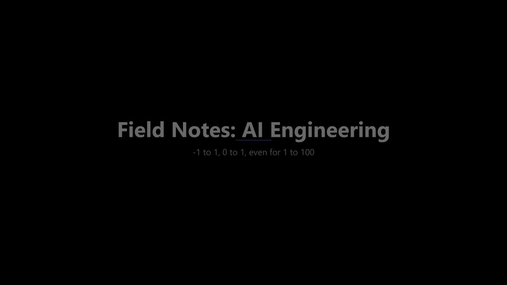

There's a strange gap in AI content right now. On one side, the "10 prompts to change your life" posts. On the other, research papers that assume you already have a PhD. And in the middle, the actual work of building AI systems that work, somehow still the quietest part of the conversation.

I started my journey with AI research when BERT summarizers and Random Forest classifiers felt *cutting edge*, and 'agent' was still mostly a word for someone who books your flights or represents you in court. Watched the whole thing transform. Ended up on the production side building agentic systems that would have seemed completely fictional to the version of me writing fine-tuning scripts in academia.

That transition from research to shipping is where most of the real learning came together. Not just from papers. Not just from tutorials. From building things, figuring out why they behaved the way they did, and reading-writing it down. Most of it I wrote down just to make sense of it myself. After a while, enough had piled up that it started looking like a curriculum.

So that's what I'll be doing here. One or two articles a week under **Field Notes: AI Engineering article series**, going through the full stack of AI system design in the order it actually makes sense to learn. Here's how the series is structured and who it's for: 

It'll start with mental models and vocabulary, because without that foundation everything else floats. What's the difference between a workflow and an agent? What's context, what's retrieval, and why does treating them as the same thing lead to bad designs? What does "memory" actually mean in a system that forgets everything when the context window closes? That's the first stretch of the series.

From there it'll go into how models actually work, the parts that matter for building. How transformers process input. What tokenization means for the instructions you write. How reasoning models differ from chat models and when that distinction changes your architecture. When embeddings are the right tool. This is a layer that often gets overlooked, but ends up mattering a lot.

Then it will get into the harder design questions. How do you build an agent that can plan across steps, use tools, and validate its own outputs? What changes when you go from one agent to many? How do you design memory and retrieval so the system finds the right information, not just similar-sounding information? How do you evaluate whether it's actually working and not just appearing to work? And how do you run all of it in production without the costs, latency, and reliability turning into the real problem?

The series covers all of this. Whether you're picking up AI engineering for the first time, mid-build on something that's gotten complicated, or scaling something that already works, the structure is designed to meet you where you are and take you further. First article drops soon. 

Follow along if any of this sounds like the gap you've been feeling too.
