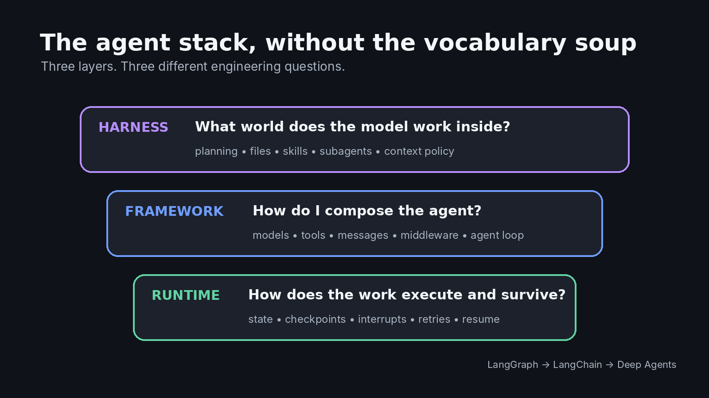
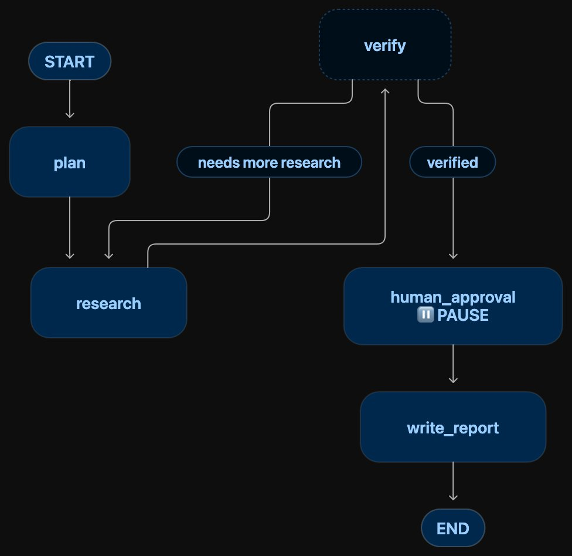
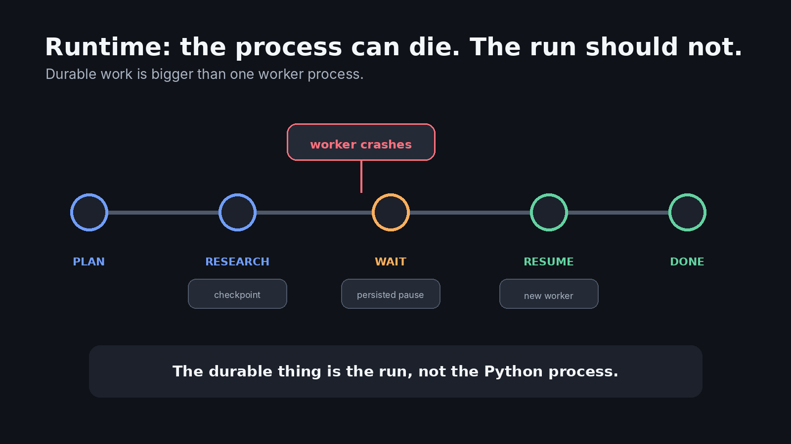
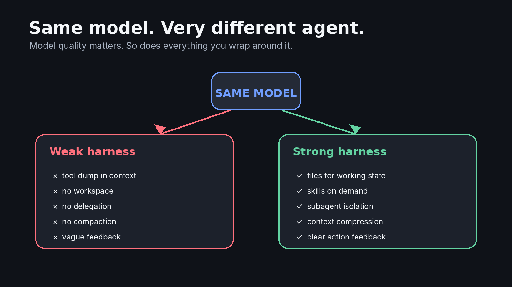
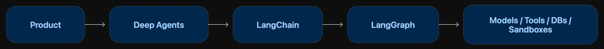
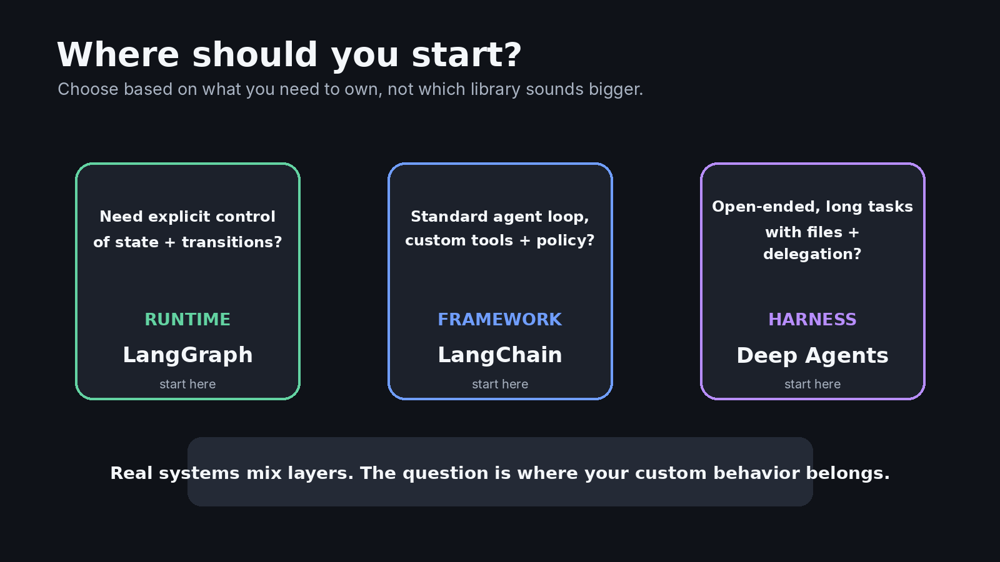

Runtime vs framework vs harness, using LangGraph, LangChain, and Deep Agents to make the stack click...

Fair warning: this is a slightly longer read. But if you clicked on it, you probably either want to clear the fog around runtimes, frameworks, and harnesses, or you already work with these systems and want to pressure-test the mental model you’ve been using.

Also, this isn’t some AI-slop write-up. I’ve been working on production agentic systems for academia, and a lot of this comes from the things I’ve had to learn, build, break, and explore along the way. Call it roughly 70% me, 30% AI-assisted polishing 🤠.

Agent engineering has a naming problem.

We call almost everything between an LLM API and a product an **agent framework**.

That was mostly harmless when an “agent” meant a model, a few tools, and a loop. It gets confusing now that agents can run for minutes or hours, pause for approval, write files, spawn subagents, recover from failures, remember things across sessions, and carry a task across multiple context windows.

At that point, “framework” is doing far too much work as a word.

A cleaner mental model is starting to emerge:

> **A runtime keeps the work alive. A framework makes the agent programmable. A harness makes the model effective at the work.**

LangChain’s own stack is a useful way to see this separation:

- [LangGraph](https://www.langchain.com/langgraph) is runtime-first.
- [LangChain](https://www.langchain.com/langchain) is framework-first.
- [Deep Agents](https://www.langchain.com/deep-agents) is harness-first.

The important word there is *first*. These boundaries are not laws of physics. LangGraph is also a framework. LangChain already includes a minimal harness. Deep Agents obviously contains framework-like abstractions. Harrison Chase has explicitly called the terminology “murky” and overlapping. [[1]](https://www.langchain.com/blog/agent-frameworks-runtimes-and-harnesses-oh-my)

Still, the distinction is useful because each layer answers a different engineering question.



## Start with one agent, not three definitions

Suppose you are building a research agent.

The user gives it a task that sounds simple:

> Research whether cultivated meat can realistically reach price parity with conventional beef. Compare the evidence, run the numbers, make charts, and give me a report.

The model starts working.

It searches. It reads papers. It saves notes. It runs some Python. It realizes one assumption is weak and searches again. It delegates environmental analysis to another worker. Halfway through, it needs approval before using an expensive data source. Seventeen minutes in, a process dies.

Now ask three different questions.

1. **Can the task resume without starting over?** That is a *runtime* question.
2. **How did we define the model/tool loop, middleware, tools, and state transitions?** That is a *framework* question.
3. **Why did the model know to make a plan, keep bulky results in files, delegate a subtask, and avoid stuffing everything back into its context window?** That is a *harness* question.

Same agent. Three layers of responsibility.

That is the distinction worth remembering.

## Runtime: can the work survive reality?

The easiest way to understand a runtime is to stop thinking about intelligence for a moment.

Imagine the model is already smart enough.

Production still has ugly questions:

What if the worker crashes?

What if the agent has to wait six hours for a person to approve something?

What if you deploy new code while twenty runs are active?

What if the task branches into parallel work?

What state needs to survive between steps?

What happens when an API fails halfway through a node?

This is runtime territory.

LangGraph is a clean example because its core abstractions are built around **state and execution**. You describe work as nodes connected through transitions, and the runtime can checkpoint state at boundaries, pause on an interrupt, retry work, and later resume from persisted state. [[2]](https://docs.langchain.com/oss/javascript/langgraph/thinking-in-langgraph)

A simplified workflow might look like this:



The important part is not the boxes.

It is that human_approval can be a *real pause*, not a theatrical prompt saying “please come back later.” The graph state can be checkpointed, the process can disappear, and execution can resume when input arrives. LangGraph’s documentation shows exactly this pattern with interrupt() plus a checkpointer, including runs that resume days later.

That gives us a useful one-line definition:

> **The runtime owns the lifecycle of the work.**

It does not primarily make the agent clever. It makes the agent’s execution dependable enough to exist outside a demo.

**A good runtime gives you boring superpowers**

Boring is a compliment here.

A strong runtime gives you things such as durable execution, persistence, retry behavior, streaming, concurrency control, interrupts, resumability, and observability.

Those features rarely make a flashy demo.

You notice them the first time a 25-minute agent run fails at minute 24.

Without a runtime, “long-running agent” often means “a Python process we hope stays alive.”

With one, the process becomes replaceable. The *run* is the durable thing.



## Framework: how do I express the agent I want?

Now move one layer up.

Even with durable execution underneath, you probably do not want to hand-write the same plumbing for every agent:

- model invocation
- tool schemas
- message conversion
- structured output
- model/tool loops
- provider integrations
- middleware hooks
- state updates

A framework gives you a programming model for those pieces.

This is where LangChain fits well.

The current LangChain agent abstraction is intentionally small: a model runs in a loop, decides when to call tools, receives the results, and continues until it can answer. Middleware lets you intercept and modify that loop without rebuilding the whole thing. [[3]](https://www.langchain.com/blog/deep-agents-vs-langchain-vs-langgraph)

Conceptually:

```python
agent = create_agent(
    model=model_name,
    tools=[search, read_document, run_python],
    middleware=[summarize_context, require_approval]
)
```

Do not get hung up on the API. The useful idea is **where the abstraction sits**.

Instead of writing:

> call model → parse tool request → execute tool → serialize result → append messages → call model again → handle error → repeat

you work with concepts such as *agent*, *tool*, *message*, *middleware*, and *model*.

That is what frameworks are good at: giving repeated engineering patterns a vocabulary.

A good framework removes enough boilerplate that you can focus on your application, while still letting you reach underneath when the abstraction stops fitting.

And that second part matters.

Anthropic’s long-standing advice is still useful here: frameworks accelerate common work, but too many layers can hide the prompts and responses that actually determine behavior. Their recommendation is not “never use frameworks.” It is to understand what sits underneath the abstraction and add complexity only when it earns its place. [[4]](https://www.anthropic.com/engineering/building-effective-agents)

So:

> **The framework owns the developer-facing building blocks of the agent.**

It answers: *How do I compose this system without writing every low-level interaction myself?*

## Harness: what kind of world are you putting the model inside?

This is the newer, and more interesting, layer.

Take the same model twice.

In system A, give it:

```
- 40 vaguely named tools
- a giant conversation history
- no workspace
- no plan
- no way to delegate
- no strategy for oversized tool outputs
- one massive system prompt explaining everything
```

In system B, give it:

```
- a small, legible toolset
- a filesystem for intermediate work
- planning support
- skills loaded only when relevant
- subagents for isolated work
- automatic context compression
- clear approval boundaries
- good feedback after every action
```

The underlying model can be identical.

The resulting agent will not feel identical.

That surrounding system is what people increasingly mean by an **agent harness**.



A harness is more opinionated than a general framework. It does not just give you primitives and ask what you want to build. It arrives with ideas about **how a capable agent should work**.

Deep Agents is a good example.

Its default setup includes planning, filesystem tools, subagent spawning, skills, memory, context management, human-in-the-loop support, and prompts that teach the model how to use those capabilities. [[5]](https://docs.langchain.com/oss/javascript/deepagents/overview)

The filesystem part is especially revealing.

A naive long-running agent treats the context window like RAM, disk, notebook, and event log at the same time. Every search result gets appended. Every intermediate thought competes with every future instruction. Eventually the model is reading an increasingly expensive pile of history just to figure out what matters now.

A harness can change that operating model.

Large information can move to files. The model can read only the relevant slice later. A specialized subagent can investigate one branch without polluting the parent agent’s context. Old conversation history can be summarized. A skill can stay on disk until the task actually needs it.

That is not merely prompt engineering.

It is **context engineering**: deciding what enters the model’s limited working context, when, and in what form. Anthropic describes context engineering in almost exactly those terms: curating the evolving set of instructions, tools, external data, and message history that reaches the model during inference. [[6]](https://www.anthropic.com/engineering/effective-context-engineering-for-ai-agents)

LangChain’s 2026 description of Deep Agents makes the same point even more directly: the job of a harness is to get the right context to the model at the right time. [[7]](https://openai.com/index/unlocking-the-codex-harness)

So:

> **The harness owns the model’s operating environment.**

Not the compute environment in the Docker/Kubernetes sense. The *cognitive* environment: tools, instructions, working files, delegation patterns, context policy, memory policy, and the feedback loop around actions.

This also explains why coding agents made the term “harness” much easier to see.

OpenAI describes Codex as a harness containing the agent loop, thread lifecycle, persistence, configuration, authentication, tool execution, MCP integrations, skills, and approval flows.[8] Separately, it describes the **environment** as the place where commands actually execute and files live.[[9]](https://www.anthropic.com/engineering/effective-harnesses-for-long-running-agents)

That distinction is useful:

> A sandbox gives the agent a computer. A harness teaches the agent how to operate through it.

## The part that usually causes confusion: the layers overlap

Here is where neat diagrams can lie to you.

Memory exists in the *runtime* and the *harness*.

Human approval exists in the *runtime* and the *harness*.

Files can belong to the *environment* and the *harness*.

Retries can be implemented by the *runtime*, *middleware*, or *application code*.

So how do you know which layer owns what?

The trick is to ask **what responsibility is being solved**.

**Memory is a good example here:**

A runtime may persist a checkpoint containing:

```json
{
  "task": "compare five papers",
  "completed": ["search", "extract"],
  "next_step": "synthesis",
  "artifacts": ["notes.md"]
}
```

That is execution memory. It answers:

**Can the run continue correctly?**

The harness may look at everything available and decide:

```
For the next model call:
- include the current plan
- include the last two tool results
- summarize the previous 40 messages
- keep raw paper extracts in notes.md
- expose the citation skill because synthesis is next
```

That is context management. It answers:

What should the model know right now?

Same broad word: memory.

Very different responsibility.

**Human-in-the-loop works the same way**

The runtime gives you the primitive:

```
interrupt → persist → wait → resume
```

The harness or application policy decides:

```
Ask for approval before:
- sending email
- spending > $5
- deleting a file
- publishing an artifact
```

One provides the mechanism.

The other decides how the model should use it.

This distinction becomes extremely useful when you are designing your own agent stack because it tells you *where a feature belongs*.

Do not put “resume after process crash” into a giant system prompt.

Do not make your orchestration engine decide whether financial-analysis/SKILL.md should enter the next model context.

Different layer. Different job.

## So what is Deep Agents actually adding on top of LangChain?

This is the fastest way to make the whole stack click.

LangChain already gives you an agent loop.

Deep Agents is not replacing that loop with some mysterious new form of intelligence.

It is adding a set of opinionated behaviors around it.

LangChain itself describes Deep Agents as essentially its core agent plus a collection of middleware and context-management defaults.

That includes things such as:

- a planning/todo mechanism
- filesystem access
- subagent delegation
- skills
- memory
- context summarization and offloading
- default instructions for using all of the above

And underneath that, LangChain’s agent abstraction runs on LangGraph.[7:2]

So the stack is roughly:



That does **not** mean every agent stack in the world must have exactly these three packages.

It means these three projects happen to expose three architectural responsibilities unusually clearly.

You can build your own harness on LangChain.

You can use LangGraph directly and skip LangChain’s agent abstraction.

You can build a harness from raw model APIs and Temporal.

You can use a managed harness where much of this is hidden behind an API.

The names matter less than knowing which responsibilities you have chosen to own.

## Which layer should you start from?

There is no universal answer, but there is a useful decision rule.



If the **workflow itself is the product logic**, start lower.

A compliance process with fixed gates, a financial approval workflow, or a support system with strict routing may benefit from LangGraph-style explicit control. You want to know where the system can go next, what gets persisted, and exactly where a human can intervene.

If the **agent loop is normal but the application is custom**, a framework is often the sweet spot.

Maybe the agent needs your retrieval stack, your tools, your auth model, and two pieces of custom middleware. You do not need a built-in planner, filesystem, or swarm of subagents just because they exist.

If the work is **open-ended and long-horizon**, a harness starts earning its weight.

Research, coding, data analysis, complex document production, investigation, and other tasks where the model has to decide *how* to make progress benefit from planning, files, delegation, skills, and deliberate context management.

And yes, real systems mix them.

You might have a deterministic LangGraph workflow whose “research” node invokes a Deep Agent. Or a Deep Agent whose sensitive tool calls ultimately trigger runtime-level interrupts. These layers compose because they solve different problems.

The wrong question is:

> Which one wins: LangGraph, LangChain, or Deep Agents?

The better question is:

> **At which layer does my application need to be opinionated?**

If you need to own every state transition, work close to the runtime.

If you need to own the agent composition, work at the framework.

If you mostly want to own the domain while inheriting a strong general-purpose operating model, start from a harness.

That is normal for a stack this young.

What matters is not winning the terminology argument.

It is knowing what you are buying, what you are abstracting away, and what you still own when your “agent framework” becomes a production system.

## Refs :))

1. Harrison Chase, “Agent Frameworks, Runtimes, and Harnesses — oh my!”, LangChain, October 25, 2025. <https://www.langchain.com/blog/agent-frameworks-runtimes-and-harnesses-oh-my>
2. LangChain, “Thinking in LangGraph.” <https://docs.langchain.com/oss/javascript/langgraph/thinking-in-langgraph>
3. Sydney Runkle, “Deep Agents vs LangChain vs LangGraph,” LangChain, August 6, 2026. <https://www.langchain.com/blog/deep-agents-vs-langchain-vs-langgraph>
4. Anthropic, “Building Effective Agents,” December 19, 2024.  <https://www.anthropic.com/engineering/building-effective-agents>
5. LangChain, “Deep Agents overview.” <https://docs.langchain.com/oss/javascript/deepagents/overview>
6. Anthropic, “Effective Context Engineering for AI Agents.” <https://www.anthropic.com/engineering/effective-context-engineering-for-ai-agents>
7. OpenAI, “Unlocking the Codex Harness: How We Built the App Server,” February 4, 2026.  <https://openai.com/index/unlocking-the-codex-harness/>
8. OpenAI, “Architecture: Understand the Harness, Environment, and Application Server.”  <https://developers.openai.com/api/docs/guides/agents-api/architecture>
9. Anthropic, “Effective Harnesses for Long-Running Agents,” November 26, 2025.  <https://www.anthropic.com/engineering/effective-harnesses-for-long-running-agents>
