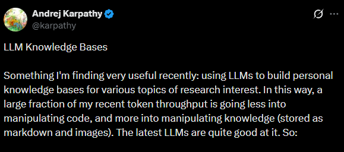
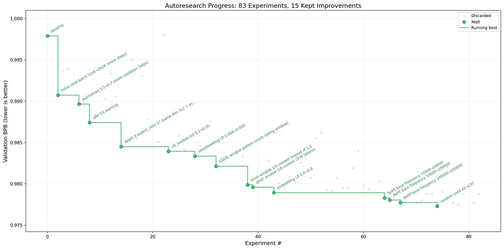
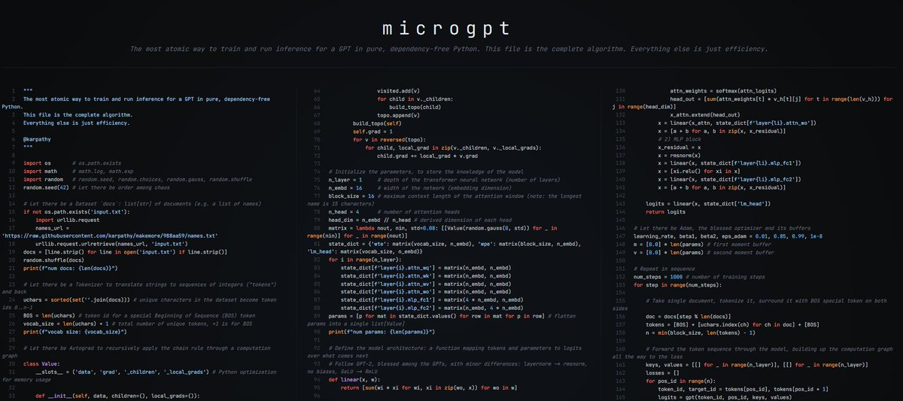
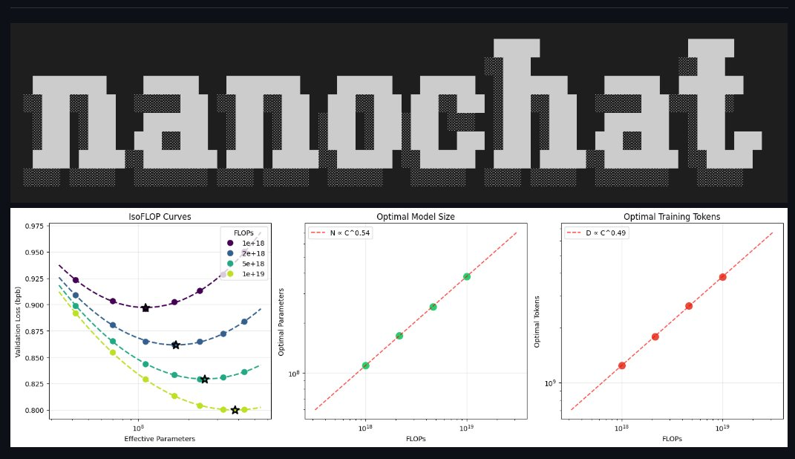

Every generation of tech had its North Star.

In the 90s, people looked up to Bill Gates. In the mobile era, Steve Jobs. In the startup wave, Zuckerberg and Musk were on every mood board.

In the LLM era, there's one name that keeps coming up in every serious builder's conversation. Not because of a product launch or a funding round. Just because of the quality of thinking and the consistency of output over the period of time.

**Andrej Karpathy (**[**@karpathy**](https://x.com/@karpathy)**)**

I'm writing this not just as a fan post but as someone who genuinely admires the kind of work he has been dropping on the internet for a long time now. Let's take a quick look at some of the gems he has given people to think upon and build from lately.

And if you are reading this, please don't leave without dropping a thank you note for him and people like him who keep providing this much value without needing a reason.

## LLM Wiki: your knowledge base should compound, not repeat

On April 3rd he posted about a shift in how he personally uses LLMs.

Not a product, not a repo, just describing his own workflow: he had stopped using AI mainly to generate code and started using it to build and maintain a living knowledge wiki from his raw research material. His wiki on a single topic had grown to around 100 articles and 400,000 words, and he rarely touches it directly. The LLM reads sources, extracts concepts, builds interlinked markdown pages, and keeps them updated as new material comes in.

The tweet crossed 18M+ views. People went a bit crazy.

The next day he followed up with what he called an "idea file," a GitHub gist not meant as an app or a library but as something you copy-paste into an LLM agent and let it build a custom version for your own setup. His framing: **"Obsidian is the IDE, the LLM is the programmer, the wiki is the codebase."**

Within five days the gist had 5,000 stars and at least 15 working community implementations on GitHub. The idea itself is the product now.

<https://gist.github.com/karpathy/442a6bf555914893e9891c11519de94f>

## autoresearch: AI doing ML research while you sleep

In March 2026 he released **autoresearch**, a 630-line Python repo that lets an AI agent run ML experiments overnight on a single GPU without you touching anything.

The setup: you write a plain English markdown file describing what to explore. The agent edits the training code, runs a 5-minute experiment, checks if validation loss improved, keeps or reverts the change, and loops. About 100 experiments while you sleep.

He pointed it at his own already-optimized nanochat codebase and the agent caught a bug he had missed for months.

The line from his README captures it well: **"You are not writing the code directly 99% of the time. You are orchestrating agents who do and acting as oversight."**

<https://github.com/karpathy/autoresearch>

## microgpt: a complete GPT in 243 lines, zero dependencies

In February 2026 he dropped a single Python file called microgpt.

243 lines. The only imports are os, math, random, and argparse. No PyTorch, no NumPy, nothing. Inside those lines he builds a tokenizer, an autograd engine from scratch, the full transformer architecture, the Adam optimizer, a training loop, and inference. All readable in one sitting.

The comment at the top of the file: **"The most atomic way to train and run inference for a GPT in pure, dependency-free Python. This file is the complete algorithm. Everything else is just efficiency. I cannot simplify this any further."**

an "art project." 

<https://karpathy.ai/microgpt.html>

## nanochat: build your own ChatGPT for $100

In October 2025 he released nanochat, which he described as "the best ChatGPT that $100 can buy."

Not a wrapper. A complete end-to-end pipeline covering tokenization, pretraining, supervised finetuning, RL with GRPO, inference with KV caching, and a web UI you can actually talk to. 

Boot up a cloud GPU node, run one script, and in roughly 4 hours you're having a conversation with your own LLM. He is building it as the capstone project for LLM101n, his upcoming course through Eureka Labs.

The point is not to compete with GPT-4. The point is that builders who understand the full stack end up making better decisions at every layer, no matter what they're building on top of.

<https://github.com/karpathy/nanochat>

If you're building anything in AI right now, go follow him at [@karpathy](https://x.com/@karpathy). And if any of these projects gave you even one useful idea, take 30 seconds to tell him that. 

**Tag him. Tell him. Let this reach him.**
