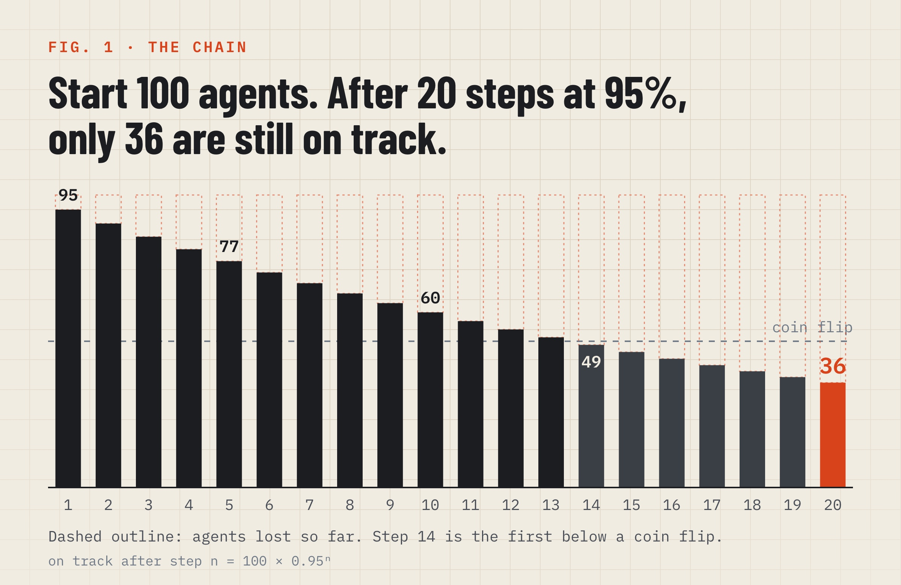
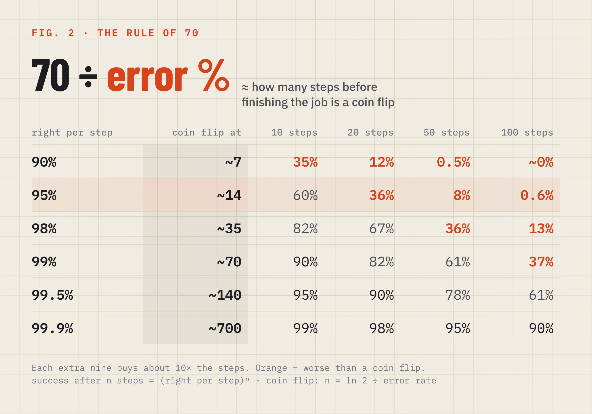
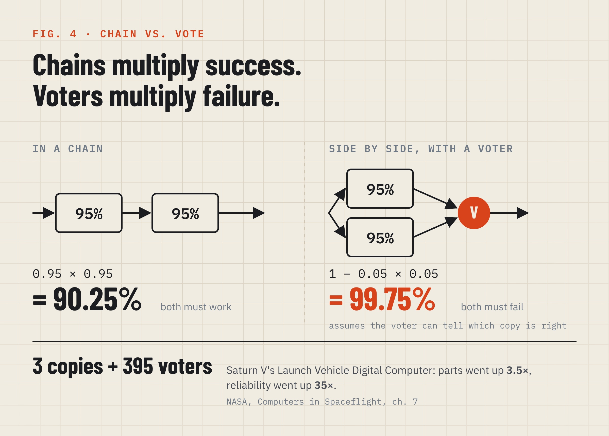
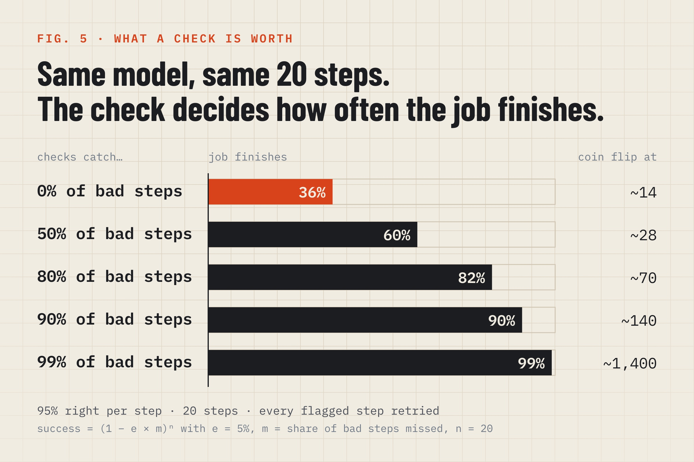
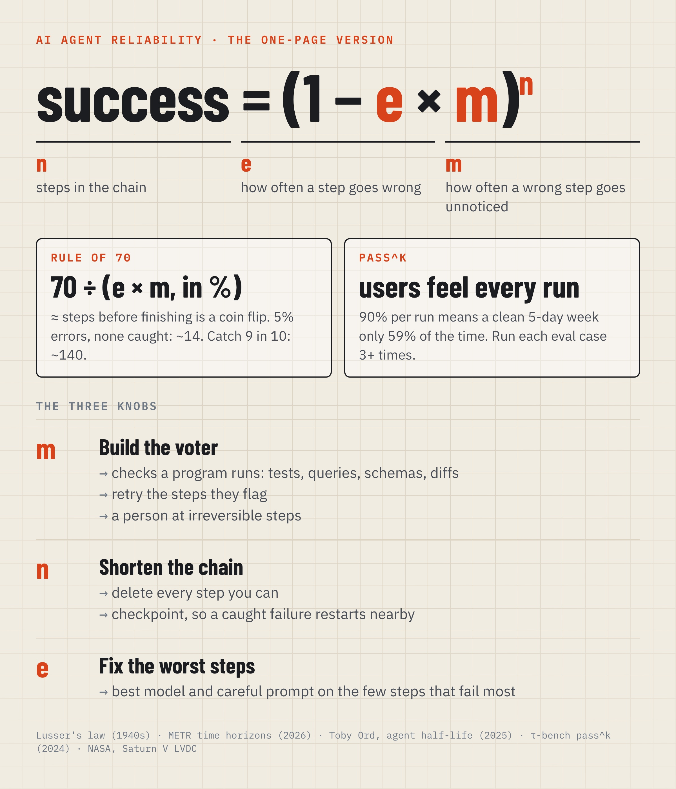

*An agent can be right at almost every step and still fail most long jobs. Missile engineers hit the same math in the 1940s, and the fix flew on the Saturn V.*

Take an AI agent that gets each step of a job right 95% of the time. Give it a job with 20 steps. It will finish about 36% of the time.

Nothing in that agent is broken. Every step really is 95% reliable, and the job still fails, because of arithmetic that missile engineers worked out in the 1940s and that people building agents keep relearning the expensive way.

## Finishing means every step goes right

Say the job is fixing a bug: read the issue, find the right file, understand the code around it, write the change, run the tests, read what failed, and so on, twenty steps in all. The job counts as done only if every step goes right. Pick the wrong file at step two and the next eighteen steps are careful work on the wrong problem.

So picture each step as a gate that opens 95% of the time, and send 100 agents through. About 95 get past the first gate. Of those, about 90 get past the second, then 86, 81, 77. Each gate takes its 5% from whoever survived the gates before it. After twenty gates, about 36 of the 100 are still going.

As arithmetic: success across a chain is the success of one step multiplied by itself once per step. 0.95 to the power of 20 is 0.36.

We grow up hearing that a chain is as strong as its weakest link. For reliability that's too generous: every link gets its own chance to break, so a chain is weaker than its weakest link. This one has no weak link at all, and it still breaks about two times out of three.

## Missile engineers hit this wall first

The problem is older than software. In the usual telling, the first ten V-1 flying bombs that German engineers tested all failed, blowing up on the launch pad or coming down short, even though every part had been carefully made. Robert Lusser, an engineer brought in to find out why, showed that the answer was multiplication: when a machine works only if every part works, its reliability is the reliability of each part multiplied together. Reliability engineers know this as Lusser's law.

Good parts, bad machine. An agent is a machine made of steps. When a lab reports that a model is 95% accurate, that number describes the parts. Whether your job gets done also depends on how many parts you chain together, and that number almost never makes it into the launch post.

## The Rule of 70

How long can the chain get before it breaks more often than it holds? You can work it out in your head:

**Divide 70 by the error rate in percent. That's roughly how many steps the agent can take before finishing becomes a coin flip.**

- **10% error rate:** about 7 steps.
- **5%:** about 14 steps.
- **1%:** about 70 steps.
- **0.1%:** about 700 steps.

The 70 comes from the math of halving. A coin flip means 0.95ⁿ = ½. Take logs and n = 0.693 ÷ 0.051, which is about 13.5 steps. For small error rates the number on the bottom is almost exactly the error rate itself, so the steps you get are about 0.7 divided by the error rate, or 70 divided by it in percent. Economists use the same shortcut for doubling times (money growing 7% a year doubles in about ten years), because halving is the same math run backwards.

It also tells you what accuracy buys. Each extra nine, from 99% to 99.9% to 99.99%, buys about ten times as many steps.

## The people who measure agents see the same curve

METR, a research group that tests what AI agents can do, scores models by their "time horizon": the length of task, in the hours a skilled human would need, that an agent completes half the time. It's the coin-flip point, counted in hours of human work instead of steps.

In a report published in May 2026, METR put the best public agents at a horizon of about 12 hours at 50% success. When it raised the bar to 80%, the horizon fell to about an hour and a half. Asking for 80% instead of 50% cut the job you could hand over by about eight times.

The philosopher Toby Ord worked out the simplest version of this. If an agent runs the same small risk of failing in every minute of a task, its success decays the way a radioactive isotope does, and the 50% horizon is its half-life. That model predicts an 80% horizon about a third as long as the 50% one. METR measured about an eighth, so on these numbers real agents fall off even faster than the simple model says.

The same model puts the 99% horizon at about one seventieth of the 50% horizon. There's the 70 again. For an agent that handles 12-hour tasks half the time, that's roughly ten minutes of work you could trust at 99%, and if the real curve is steeper, less. METR itself warns that a 50% horizon of X hours doesn't mean you can hand an AI tasks under X hours.

## Your users run the chain every day

Everything so far describes one attempt at one job. Your users make many.

You test an agent by running a task once, watching it work, and feeling good. Your users run it every day, and what they feel is whether it works every time. That's the same multiplication, across days instead of steps: an agent that works 90% of the time gives a daily user a clean work week 59% of the time.

The team behind τ-bench, a benchmark from Sierra that simulates customer-service conversations, named this pass^k: the chance an agent solves the same task in all k attempts. In their June 2024 paper, GPT-4o solved about 61% of retail tasks on one try. Asked to solve each task eight times out of eight, it fell below 25%.

.")

That figure is also where the clean math cracks. If each attempt were an independent 61% coin, eight in a row would come up about 2% of the time. The measured number is more than ten times higher, so the arithmetic is missing something.

## What the clean math gets wrong

Before trusting an equation, check what it assumes. This one assumes three things.

First, that every step is equally risky. Reading a file almost never fails; deciding which file to read often does. Most of the risk sits in a few hard steps, and "95% per step" is an average that hides them.

Second, that failures are independent. They aren't, in either direction. In τ-bench the agent passes some tasks every time and fails others every time, which is why eight-for-eight beat the coin. Within a single task it cuts the other way: a 2025 study of long tasks found that models make more mistakes once their own earlier mistakes are in the context, an effect the authors call self-conditioning.

Third, that a wrong step stays wrong. This is the assumption that matters most, because real agents get feedback as they go. A command errors out, a test fails, a person pushes back, and a mistake that gets noticed can be fixed.

A mistake that gets caught costs a retry. A mistake nobody catches becomes the foundation for every step after it, and only those enter the multiplication. So the number to multiply is how often a step goes wrong and nobody notices. Put that into the multiplication and you get:

**success = (1 − e × m)ⁿ**

n is the number of steps in the chain. e is how often a step goes wrong. m is the miss rate: how often a wrong step goes unnoticed. e × m is the silent error rate, and the Rule of 70 works on that.

Each letter is a knob you can turn. Nearly all the attention in AI goes to e: bigger models, better prompts. The other two are usually cheaper to turn, and engineers worked out how to turn m sixty years ago.

## Engineers fixed it with a voter

To shrink m, something has to tell a good step from a bad one. Engineers did it by running copies side by side and letting a vote decide.

In a chain you multiply the chances of success, so two 95% parts give 90%. Side by side, with a voter that can tell which one is right, you multiply the chances of failure instead: 1 − 0.05 × 0.05 = 99.75%.

The computer that steered the Saturn V was built this way. IBM gave the Launch Vehicle Digital Computer three copies of its logic and 395 voters, small circuits that compared the copies and overruled any one that disagreed. According to NASA's history of the program, the parts count went up 3.5 times and reliability went up 35 times.

Three copies with nothing comparing them are three computers that can each be wrong. Redundancy pays only when something can tell a good result from a bad one.

In an agent, the voter is a check: run the tests, query the database to see whether the row changed, validate the output against its schema, diff the file against what was asked. When a check flags a bad step, the agent retries it, and a silent failure becomes a short delay.

Run the numbers on the same agent, 95% per step over 20 steps, retrying every flagged step. With no checks it finishes 36% of the time. With checks that catch half the bad steps, the silent error rate halves to 2.5%, and 0.975²⁰ is about 60%. With checks that catch nine in ten, about 90%. The model and the job haven't changed, and the coin-flip point has moved from about 14 steps to about 140.

The voter has to stand outside the model's head. A 2023 paper with the blunt title "Large Language Models Cannot Self-Correct Reasoning Yet" found that models asked to fix their own reasoning without outside feedback mostly can't, and sometimes make it worse. Give the model an outside check and more attempts keep paying off: in the "Large Language Monkeys" study, one open model found a passing fix for 15.9% of a set of real GitHub issues with one attempt and for 56% within 250 attempts, because the issues' own tests could check every attempt.

Asking the model "are you sure?" adds a copy with no voter.

## The equation, turned into a checklist

Every fix for an unreliable agent turns one of the three knobs. Before you ship an agent, go through them:

- **Give every risky step a voter (m).** Prefer checks a program runs over checks a model guesses at, and retry what they flag. Anthropic's guide to building agents calls this getting "ground truth" from the environment at each step.
- **Put a person at the irreversible steps (m).** Payments, deletions, emails to customers. A person can judge what no program can.
- **Count the steps (n).** List every step in a typical run. Each one you delete is reliability you don't have to earn.
- **Save progress (n).** Checkpoint the work, so a caught failure at step 15 sends you back to step 10 instead of step 1.
- **Spend your best model on your worst steps (e).** Find the few steps that cause most failures and put the expensive model and the careful prompt there.
- **Find your coin-flip point.** Estimate the silent error rate from real traces and divide 70 by it. If a typical job runs longer than that, prompt tweaks won't save it; the design has to change.
- **Measure pass^k, not one good run.** Run every eval case at least three times, and count it as passing only when every run passes.

## Good parts, bad machine

Lusser showed that you can build a bad machine entirely out of good parts. The Saturn V's computer showed the way back: its parts could fail like anyone's, and 395 small circuits were there to notice when one did.

Better models will keep coming, and each one will lower e. The agents that finish long jobs will be the ones whose builders also built the voter.

## Sources

- [MacTutor, History of reliability (V-1, Lusser's law)](https://mathshistory.st-andrews.ac.uk/Extras/reliability_history/)
- [METR, Measuring AI Ability to Complete Long Tasks (2025)](https://arxiv.org/abs/2503.14499)
- [METR, Frontier Risk Report (May 2026)](https://metr.org/blog/2026-05-19-frontier-risk-report/)
- [METR, Clarifying limitations of time horizon (Jan 2026)](https://metr.org/notes/2026-01-22-time-horizon-limitations/)
- [Toby Ord, Is there a half-life for the success rates of AI agents? (2025)](https://www.tobyord.com/writing/half-life)
- [Yao et al., τ-bench (2024)](https://arxiv.org/abs/2406.12045)
- [Sinha et al., The Illusion of Diminishing Returns (2025)](https://arxiv.org/abs/2509.09677)
- [Huang et al., Large Language Models Cannot Self-Correct Reasoning Yet (2024)](https://arxiv.org/abs/2310.01798)
- [Brown et al., Large Language Monkeys (2024)](https://arxiv.org/abs/2407.21787)
- [NASA, Computers in Spaceflight, ch. 7 (Saturn V LVDC)](https://www.nasa.gov/wp-content/uploads/static/history/computers/Ch7-2.html)
- [Anthropic, Building effective agents (2024)](https://www.anthropic.com/engineering/building-effective-agents)
