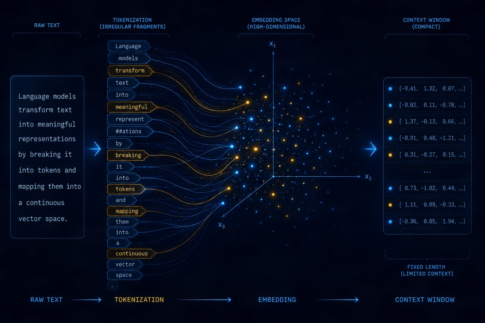
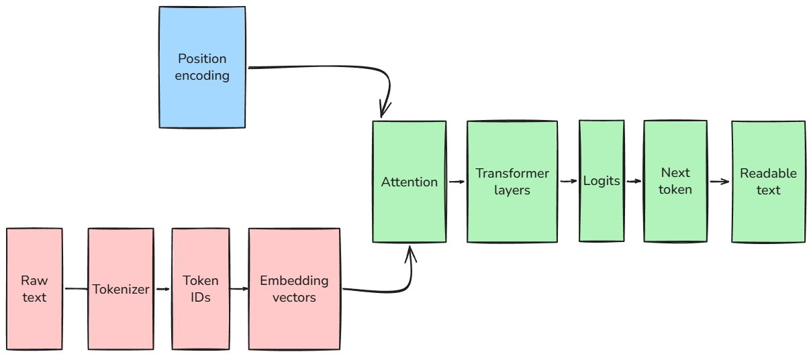
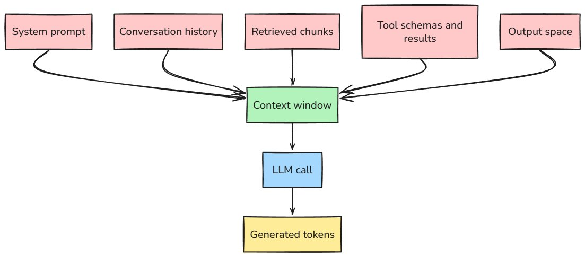
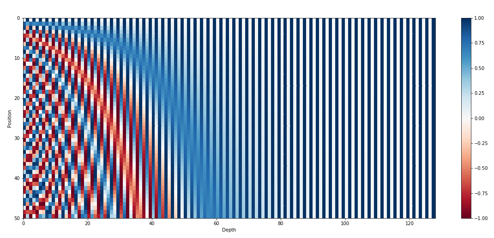
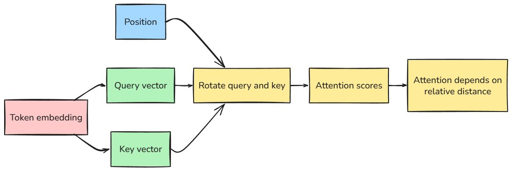

An LLM never sees the sentence you typed.

It sees a billable sequence of fragments, a geometry problem, and a position map.

That sounds like a small implementation detail until your "simple prompt" becomes 14,000 tokens, your multilingual rollout has uneven margins, or your agent ignores the one document you swear you gave it. Then the representation layer stops being theory. The bill starts there. So does a lot of the weird behavior.

The first three articles gave us the map: [system](/articles/workflow-agent-or-multi-agent/), [vocabulary](/articles/vocabulary-as-a-design-primitive/), [trade-offs.](/articles/the-nine-dials/) This is the first time the map becomes physical.

Every model call starts with tokenization. Text is split into tokens, then each token becomes an ID in the model's vocabulary. "Hello world" might become two tokens (though every model has a different conversation rate, the average is around 1 token ~ 4 characters). A long uncommon word might become a handful of fragments. Code, whitespace, punctuation, and non-English text can behave very differently from clean English prose.

The annoying part: tokens are model-specific. The same prompt can be 1,900 tokens for one tokenizer and 2,400 for another. Even the same visible string can split differently when there is a space before it. The OpenAI tokenizer docs call this out directly: spaces are often grouped with the start of words. So "red" and " red" may not be the same token sequence.

That leading space you ignored in your prompt template? The tokenizer noticed. It always notices. Great little accountant, terrible conversationalist.

Most modern tokenizers are based on Byte Pair Encoding or a close relative. The reason is simple: language is open vocabulary. No fixed word dictionary can cover every name, typo, chemical formula, product SKU, variable name, and newly invented framework someone announced last Tuesday.

[BPE](https://huggingface.co/learn/llm-course/chapter6/5) starts with tiny pieces, then repeatedly merges frequent pairs. Common fragments get their own token. Rare fragments get built from smaller ones. That means "ing" may become a reusable piece, while a weird internal ID gets chopped into a sad parade of characters and symbols.

[SentencePiece](https://arxiv.org/abs/1808.06226) takes a related idea and trains directly from raw sentences, which matters for multilingual systems because it does not assume your text was already split into neat words. This is one of those details that sounds academic until you ship for users writing in Japanese, Arabic, Malayalam, or a code-mixed mess of English and Hindi. Which is to say: normal humans.

This matters because token count is the unit your system pays for and the unit your model can fit. Not characters. Not words. Tokens.

Here is the smallest useful habit I want every builder to pick up:

```
import tiktoken

enc = tiktoken.encoding_for_model("gpt-4o-mini")

samples = [
    "unbelievable",
    " unbelievable",
    "refund policy",
    "returns are accepted within 30 days",
    "user_id: 8f14e45fceea167a5a36dedd4bea2543",
]

for text in samples:
    token_ids = enc.encode(text)
    pieces = [enc.decode([token_id]) for token_id in token_ids]
    print(len(token_ids), pieces)
```

The exact numbers are less important than the habit. Count with the model tokenizer before pricing, chunking, or deciding whether something "fits." Estimates are fine for a napkin. They are not fine for the path that decides what your agent sees.

And count the wrapper too. Chat messages have formatting overhead. Tool schemas consume tokens. Function definitions are not free just because they sit in the tools field instead of the user prompt. The OpenAI Cookbook says message token counting can change by model, and tool calls add extra tokens beyond simple text estimates. That is why production systems should log API usage from the response, not only local estimates.

A 128k context window sounds enormous. Roughly, it can hold tens of thousands of English words. But working systems do not get to spend that whole budget on useful documents. They spend it on the system prompt, previous messages, retrieved chunks, tool results, tool schemas, hidden formatting, and space for the answer. By the time the model starts generating, the budget already has fingerprints all over it.

That is why token counting belongs in the engineering path, not the finance dashboard. If you only discover token growth when the invoice arrives, the bug has been running in production for a while.



After tokenization, IDs become embeddings.

At that point, the model stops dealing with arbitrary integers and starts dealing with geometry. Token ID 341 and token ID 342 are not similar because the numbers are close. The IDs are just labels. The embedding table maps each ID to a dense vector, a long list of floats. In that vector space, tokens with related meanings can land near each other.

The familiar example is "king minus man plus woman is queen." Fine example. Slightly overworked. The useful version for builders is simpler: embeddings let systems compare meaning without relying on exact words. A search for "refund policy" can retrieve a paragraph that says "returns are accepted within 30 days" because the vectors carry semantic closeness.

That is the promise, anyway.

In practice, embedding quality shows up as retrieval behavior. Search for "Can I withdraw my manuscript after acceptance?" and the right policy page might say "post-acceptance cancellation requests require editorial approval." A keyword system might miss it. A good embedding model should bring those closer. But if your chunk is poorly cut and the phrase "post-acceptance" is separated from the actual rule, the vector may represent the wrong thing. Then your retriever confidently brings the wrong paragraph. Very elegant. Very useless.

But there are two different embedding conversations that often get mashed together.

Inside an LLM, token embeddings are the starting point. They enter the transformer, attend to other tokens, and become contextual representations. The vector for "review" should behave differently in "peer review," "code review," and "review this invoice." The model is not carrying one fixed dictionary meaning through the whole network.

In a retrieval system, an embedding model produces vectors for chunks and queries so you can compare them with cosine similarity or another distance measure. Those vectors are usually separate from the LLM doing generation. Different model. Different geometry. Different failure modes.

That distinction saves real debugging time. If your RAG system retrieves the wrong document, the generator may not be the problem. The search layer may have placed the right chunk far from the query. Once that happens, no amount of "please answer accurately" in the prompt can recover information that never made it into context. The model cannot reason over a document it did not receive. Very unfair, honestly, but consistent.

The representation stack looks like this:



"Logits" is the unglamorous word for the scores the model assigns to possible next tokens. The model does not write a paragraph in one shot. It predicts one next token, appends it, then predicts the next one. Over and over until it hits a stop condition or runs out of budget.

That gives generation a different performance profile from input processing. The input can be processed in a large parallel pass. Output is sequential. Each generated token depends on the tokens before it. Long answers cost more because the model is doing the next-token loop more times, not because it got emotionally invested in the response.

Streaming makes this visible. The first pause is the model reading the prompt. The trickle after that is decoding. If the first token takes forever, your input context may be huge. If tokens arrive slowly after the first one, you are watching generation speed. The UI makes the model's internal loop leak into the product. Honestly useful, if you know what you are looking at.

Structured output is the same story with stricter rules. When a model is forced to return valid JSON, the system can constrain which next tokens are allowed. After {"status":, the next token should be something that can continue a valid schema, not a random curly brace because the model felt poetic. OpenAI describes this as constrained decoding: after each generated token, the inference system masks invalid next tokens based on the schema.

That is not a prompt trick. It is representation-level control over the next-token loop. This is why structured outputs are much more reliable than "please return valid JSON" followed by a retry loop and a small prayer.

Then comes context.

A context window is the maximum number of tokens the model can process in one call, including input and output. It is tempting to treat bigger context as better memory. I do not think that frame survives contact with production.

A context window is a whiteboard. A bigger one lets you write more before the meeting ends. It still gets wiped when the call is over unless your system stores the information somewhere else.

That is the line between context and memory. Context is what the model can see right now. Memory is what your system persists and chooses to reload later. Long context can make a single call more capable, but it does not give the system continuity by itself.



The trap is context stuffing. You have a bigger window, so you put everything in. Full docs. Full conversation history. Tool traces. User profile. Previous outputs. Maybe a few "just in case" chunks, because what could it hurt?

Cost goes up first because every input token is billable. Latency follows because the model has to process the prompt before it can start answering. Quality can slip too, because long context is not the same as useful context. The "Lost in the Middle" paper tested this directly: models often performed best when relevant information was near the beginning or end of the context, and worse when the same information was buried in the middle.

The fact is technically present. The answer still ignores it. This is one of those failure modes that makes logs feel personally rude.

The practical skill is deciding what earns space.

A legal review assistant might need the exact clause, the surrounding section, and a short summary of the contract. It probably does not need 90 pages of boilerplate every time the user asks about termination terms. A coding agent might need the function being edited, nearby tests, and the API contract. It probably does not need the entire repository pasted into the prompt because the repo "fits".

Fit is not the same as relevance.

Context engineering is the system design layer around that budget. You are budgeting attention. You decide what goes in, what gets compressed, what gets retrieved, what gets dropped, and what must stay at the edge of the prompt because the model needs to follow it reliably.

Here is a rough shape of a real request budget:

```
Context window: 128,000 tokens

System prompt and policy:        2,000
Tool schemas:                    4,000
Conversation history:           12,000
Retrieved documents:            45,000
Tool results:                    8,000
Reserved output space:           4,000

Already spoken for:             75,000
Actually free:                  53,000
```

Those numbers are made up, but the pattern is not. A context window is shared infrastructure. Every component wants a slice.

There is one more piece under the floorboards: position. In papers this usually shows up as PE, positional encoding.

Self-attention is powerful, but by itself it does not know word order. Remove position information and a transformer becomes much closer to a bag-of-tokens machine. "The dog chased the cat" and "The cat chased the dog" contain nearly the same tokens. The meaning flips because the order flips.

The original Transformer paper handled this with sinusoidal positional encodings. Each position gets a vector made from sine and cosine waves at different frequencies, then that vector is added to the token embedding.

```
PE(pos, 2i)     = sin(pos / 10000^(2i / d_model))
PE(pos, 2i + 1) = cos(pos / 10000^(2i / d_model))
```



You do not need to memorize the formula. The intuition is enough: each token gets a position barcode. Dimension by dimension, the waves tick at different speeds. Position 10 and position 11 look related, but not identical. Position 10 and position 10,000 are very different. The model gets a way to reason about sequence without reading left to right like a human.

Modern LLMs often use RoPE, Rotary Position Embedding. RoPE does something more subtle than adding a position vector to the token embedding. It rotates the query and key vectors inside attention by an angle based on position. Because attention compares queries and keys, those rotations make the attention score depend naturally on relative distance.

That is the important part. With RoPE, the model can learn patterns like "pay close attention to nearby tokens" or "connect this opening instruction to later content" through the geometry of attention itself. Position is no longer just metadata attached to a token. It is baked into how tokens compare.



This is also why long context is a position problem, not only a memory problem. A model trained on 8k positions has learned a certain positional geometry. Ask it to operate at 128k and you are asking it to read positions it may not have learned well. Context-extension methods like Position Interpolation, YaRN, and LongRoPE work by changing or rescaling the position math so longer sequences look less alien to the model.

That is clever. It is also a warning label.

A bigger advertised window does not automatically mean the model uses the whole window evenly. You still need evals. Put the same critical fact near the start, in the middle, and near the end. Ask the same question. If accuracy changes by placement, your system has a position sensitivity problem, not a user education problem.

That is why prompt templates that look equivalent to humans can behave differently. Move the instruction after the examples. Put retrieved context before the user question instead of after it. Dump tool results in raw JSON at the bottom. You changed the representation the model sees. The meaning may feel the same to you. The token sequence is different to the model.

The whole stack is mechanical, but its effects feel oddly human from the outside. The model "missed" something. It "forgot" something. It "got confused." Those descriptions are useful shorthand, but they hide the engineering surface.

Often the system did something more concrete.

It split text into more tokens than expected. It retrieved the wrong vector neighbors. It buried the useful passage in the middle of 80k tokens. It left no room for the answer. It changed the order of instructions. It asked the generator to compensate for a context problem upstream.

Once you see that, debugging gets less mystical. High cost points you back to tokenization and prompt growth. Bad retrieval points you to embedding quality and chunk design. Strange long-context failures point you to placement, pruning, and summaries. The model is still probabilistic, yes. The pipeline around it is not a fog machine.

When I debug this class of issue, I usually want three views before blaming the model: a token profile, a retrieval trace, and a position test. How many tokens did each part consume? Which chunks were retrieved and why? What happens if the important passage moves from the middle to the edge of the prompt?

Those three views catch a surprising amount. The kind of surprising that makes you close a model benchmark tab and go fix your own pipeline.

The next time an AI system gives a weird answer, do not start by asking whether the model is smart enough.

Ask what text it actually saw, how that text was split, which vectors brought it there, and where the important bits landed in the window.

The model reads tokens in positions. Your system decides which ones are worth making hard to miss.

Interesting video to go through : <https://www.youtube.com/watch?v=zduSFxRajkE>

*Field Notes: AI Engineering - 1.4*

*Up next in 1.5: transformer architecture, attention, layers, and the machinery that turns these representations into useful behavior.*

## Source notes

- OpenAI Help Center - tokens, token counting, token limits, and tiktoken: <https://help.openai.com/en/articles/4936856-what-are-tokens-and-how-to-count-them>
- OpenAI Cookbook - counting tokens with tiktoken and model-specific message overhead: <https://github.com/openai/openai-cookbook/blob/main/examples/How_to_count_tokens_with_tiktoken.ipynb>
- Sennrich, Haddow, Birch - Neural Machine Translation of Rare Words with Subword Units: <https://arxiv.org/abs/1508.07909>
- Kudo, Richardson - SentencePiece: <https://arxiv.org/abs/1808.06226>
- Vaswani et al. - Attention Is All You Need: <https://arxiv.org/abs/1706.03762>
- Su et al. - RoFormer: Enhanced Transformer with Rotary Position Embedding: <https://arxiv.org/abs/2104.09864>
- Liu et al. - Lost in the Middle: How Language Models Use Long Contexts: <https://arxiv.org/abs/2307.03172>
- Chen et al. - Extending Context Window of Large Language Models via Positional Interpolation: <https://arxiv.org/abs/2306.15595>
- OpenAI - Structured Outputs and constrained decoding: <https://openai.com/index/introducing-structured-outputs-in-the-api/>
