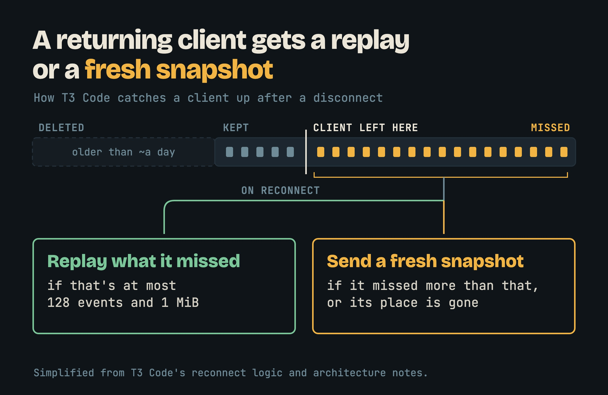

*TL;DR: Calling the model is the easy part. What keeps an agent working for hours is the code around it. Five lessons from reading OpenCode, Codex, Aider and T3 Code.*

For almost a year, I’ve been building agentic systems for academia. Lately one question has taken over for my team: how do you build a system that keeps working on a task for as long as the task needs, with no practical limit on how far it can go?

The loop at the center of any agent is easy. Call the model, run the tool it asks for, send back the result, repeat. A while loop never gets tired, and it doesn’t care whether the task takes ten minutes or ten hours.

What ends a long run is everything around that loop. A connection drops. A process dies. Three of five changes land and two don’t. The model says it’s finished while the tests are still running. The conversation outgrows the context window. In a short chat, each of these costs you a retry. Six hours into a run, any one of them can cost you the whole run.

The model can’t protect you here, because it only knows what you send it. That job belongs to the harness, which Addy Osmani defines as “every piece of code, configuration, and execution logic that isn’t the model itself.”

So I studied the harnesses of some of the best-known open-source coding agents. **OpenCode** and **OpenAI’s Codex** are coding agents that run in your terminal. **Aider** pairs a model with your Git repo. **T3 Code** is an app that runs other agents, Codex and OpenCode among them.

What surprised me most is how little of their code is about the model. Most of it deals with what happens after the model answers: checking the work, recovering when part of it fails, deciding what the model gets to see, and saving progress so a crash doesn’t wipe out hours of work. Here are the five lessons I’m taking into our own agents.

## 1. A finished reply isn’t finished work

The smallest example is a button. OpenCode hides its Copy button while a reply is still being written or retried. On screen, a half-written answer looks exactly like a finished one, so the code has to know the difference. Its comment says it plainly: “The reply is not final yet, so it offers no Copy.”

The same gap shows up all through a long run. When a model’s reply ends, Codex doesn’t assume the task is over. It checks a signal in the response that says whether the model wants another step, and if it does, Codex keeps going.

Aider shows a different gap. After each round of edits, it commits the changes to Git right away, and only then runs your linter and tests, if you’ve set them up. I think that’s the right order, because you get an undo point immediately. But it means a commit only tells you the edit was saved. It doesn’t tell you the code works.

Put together, “done” can mean at least five different things:

A long-running agent needs each of these as its own status, kept by your code. The model’s last message is one input to that status, and a poor one to rely on alone.

## 2. A good failure note does most of the self-correcting

Long tasks make many edits, and some won’t apply. Say the model asks for five changes to a file. Three apply cleanly. Two fail, because the lines it wanted to change aren’t quite what’s in the file anymore. What you tell the model next decides whether it recovers or makes things worse.

Aider has the best answer I found. It asks the model to write every change as a small find-and-replace: the exact lines to find, and what to put in their place. When some fail, Aider sends back a note. The note names each change that failed, shows the closest matching lines from the real file, and ends with this: the other changes “were applied successfully. Don’t re-send them.” Fix only the ones that failed.

That last instruction does a lot of work. Without it, a model can easily send all five changes again, including the three that already landed. Aider repeats this up to three times by default.

So when a coding agent “fixes its own mistake,” a good part of the credit belongs to the harness. It found the mistake, picked the evidence and told the model what to leave alone. In your own agent, every error message the model reads is a prompt. Write it like one: what worked, what failed, the evidence, and what not to touch.

## 3. Context is a budget you have to manage

Every long run hits the same wall: the conversation grows until the model can’t read all of it. The quick fix is to stuff in whatever fits and cut the rest. The projects I studied choose much more carefully.

Aider decides which parts of your codebase the model sees. It builds a map of the repo: which files define which functions, and which files use them. Then it ranks everything with PageRank, the idea behind Google’s original search ranking, giving extra weight to files and names you’ve mentioned in the chat. The top of that ranking goes to the model, trimmed to a token budget.

OpenCode looks after the conversation itself. It always keeps part of the window free. When the conversation gets too long, it keeps the most recent messages word for word and replaces the older ones with a summary. And it starts writing that summary early, because a summary takes 30 to 60 seconds to write, and the conversation keeps growing in the meantime.

My favorite detail comes after that. Once the summary is ready, OpenCode doesn’t swap it in straight away. AI providers charge less for the start of a prompt they’ve already seen. Swapping in the summary early would change that start and lose the discount on every step until the summary was really needed, so OpenCode waits.

For a long-running agent, that adds up to three habits: choose what goes in on purpose, start summarizing before you hit the limit, and keep the latest turns exact.

## 4. Plan for the crash before it happens

In a run that lasts hours, something will break. What matters is how much you lose when it does.

First, write things down before you act on them. T3 Code saves every incoming request with a receipt before any work starts. If a timeout makes the client send the same request again, the copy gets the original receipt back and nothing runs twice. It’s the same reason a good payment page doesn’t charge you twice when you double-click Pay.

Second, keep what you show apart from what you save. OpenCode’s live feed of updates only carries what happens from now on; the code says it holds “nothing before or across a disconnect.” Anything that must survive a crash also goes into a saved log, and that log is what you rebuild from.

Third, decide how a returning screen catches up. If it missed only a few updates, T3 replays them. If it missed a lot, T3 skips the history and sends a fresh snapshot of where things stand.

T3 also protects your files. It checkpoints your code as Git commits kept off your branch, so you can roll the files back. And if it can’t roll the conversation back to the same point, it refuses to touch the files at all, so your code and the conversation never disagree about what happened.

## 5. Start with the simplest loop that works

None of these projects has every piece, and a long-running agent doesn’t need all of them on day one.

Aider’s architect mode is the simplest design here. One model writes a plan, then a second pass turns the plan into edits, one after the other. There’s no swarm of agents talking to each other. A strict edit format, clear failure notes and plain Git get it a long way.

T3 Code sits at the other end. Because it drives several different agents, it keeps an honest list of what each one can and can’t do. Its entry for Codex, for example, says pending requests don’t survive a restart. That list is extra work, and T3 has to keep it true.

The order I’d follow: start with the simple loop, run it on long tasks, and add each piece of machinery when a real failure asks for it.

## Before your agent runs for hours

Five questions worth answering first:

- **Done:** does your code, and not just the model’s last message, know whether the work is finished, saved and tested?
- **Failures:** when three of five edits land, what exactly does the model hear next?
- **Context:** when the window fills, what stays word for word, and who chose what went in?
- **Crashes:** if the process dies at hour five, can you say what finished, what didn’t, and where to resume?
- **Size:** which of these do you need today, and which can wait for a real failure?

All of this comes from reading the code closely and testing a few functions on their own. It isn’t a benchmark, and it says nothing about which tool writes better code.

A while loop will happily run forever. Whether your agent makes it to the end depends on everything you build around it.

## Sources

- [Addy Osmani, “Agent Harness Engineering”](https://addyosmani.com/blog/agent-harness-engineering/)
- [OpenCode GitHub](https://github.com/anomalyco/opencode/tree/a9a067f12d481f65329169d94fb9177b7c0bd268)
- [OpenCode: Copy button hidden until the reply is final](https://github.com/anomalyco/opencode/blob/a9a067f12d481f65329169d94fb9177b7c0bd268/packages/session-ui/src/timeline/turn-phase-machine.ts#L68-L83)
- [OpenCode: Free room, recent messages kept, early summaries](https://github.com/anomalyco/opencode/blob/a9a067f12d481f65329169d94fb9177b7c0bd268/packages/core/src/session/compaction.ts#L42-L171)
- [OpenCode: Summary held to keep the prompt cache](https://github.com/anomalyco/opencode/blob/a9a067f12d481f65329169d94fb9177b7c0bd268/packages/core/src/session/compaction.ts#L338-L347)
- [OpenCode: Live feed versus saved log](https://github.com/anomalyco/opencode/blob/a9a067f12d481f65329169d94fb9177b7c0bd268/packages/core/src/bus.ts#L132-L171)
- [Codex GitHub](https://github.com/openai/codex/tree/748ab55ca7de0b647d9a7a9d9a8e70e00f28666d)
- [Codex: Keeps going when the model wants another step](https://github.com/openai/codex/blob/748ab55ca7de0b647d9a7a9d9a8e70e00f28666d/codex-rs/core/src/session/turn.rs#L3526-L3607)
- [Aider GitHub](https://github.com/Aider-AI/aider/tree/5dc9490bb35f9729ef2c95d00a19ccd30c26339c)
- [Aider: Commit before lint and tests](https://github.com/Aider-AI/aider/blob/5dc9490bb35f9729ef2c95d00a19ccd30c26339c/aider/coders/base_coder.py#L1585-L1623)
- [Aider: Note when only some edits apply](https://github.com/Aider-AI/aider/blob/5dc9490bb35f9729ef2c95d00a19ccd30c26339c/aider/coders/editblock_coder.py#L79-L124)
- [Aider: Repo map ranked with PageRank and fitted to a budget](https://github.com/Aider-AI/aider/blob/5dc9490bb35f9729ef2c95d00a19ccd30c26339c/aider/repomap.py#L366-L707)
- [Aider: Architect mode](https://github.com/Aider-AI/aider/blob/5dc9490bb35f9729ef2c95d00a19ccd30c26339c/aider/coders/architect_coder.py#L11-L48)
- [T3 Code GitHub](https://github.com/pingdotgg/t3code/tree/ade473018d32003658b7d38693e083ee2e314bd8)
- [T3 Code: Architecture notes (receipts, saved history, checkpoints)](https://github.com/pingdotgg/t3code/blob/ade473018d32003658b7d38693e083ee2e314bd8/docs/internals/overview.md#L45-L91)
- [T3 Code: Catching up after a disconnect](https://github.com/pingdotgg/t3code/blob/ade473018d32003658b7d38693e083ee2e314bd8/apps/server/src/orchestration-v2/ThreadStream.ts#L18-L118)
- [T3 Code: What each agent can do (Codex entry)](https://github.com/pingdotgg/t3code/blob/ade473018d32003658b7d38693e083ee2e314bd8/apps/server/src/orchestration-v2/Adapters/CodexAdapterV2.ts#L240-L315)
