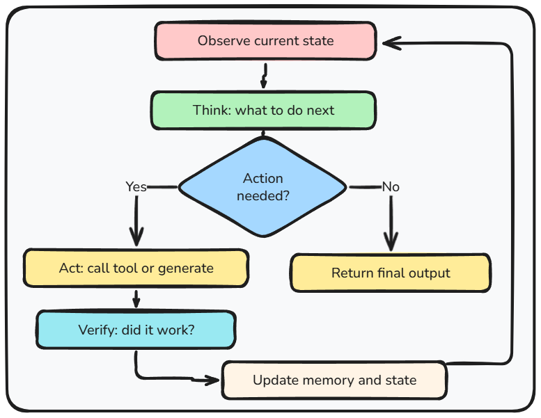
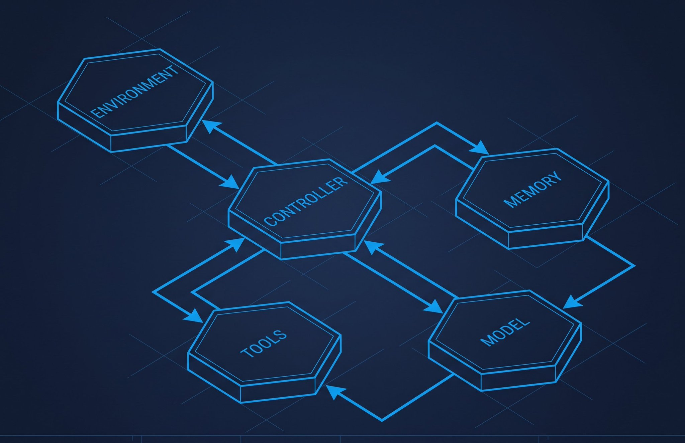

Everyone talks about AI agents. But most "agents" I see in the wild are a model call with some if-statements wrapped around it. That's not an agent. That's barely a workflow. A lot of us shipped it with a press release though when the word was making some scary "buzz" in the beginning.

The terminology matters. Not because vocabulary is worth polishing for its own sake, but because if you don't have a clear mental model of what you're building before you start, you spend the next three weeks building the wrong thing. I've done it. Most people building with AI have.

This is 1.1 of Field Notes: AI Engineering, and it starts with the mental models. If you've already shipped things in this space and some of this feels like simpler ground than you're used to, hold on. The distinctions in this first part are exactly the ones that quietly cause problems later when systems get complicated. And if you're just picking this up, you're starting in exactly the right place.

So here's the map. Three patterns. Every real AI system fits one of them.

The first is a workflow. Your code decides what happens next, and the model is one machine in the sequence. User uploads a document, your code extracts the text, calls the model to summarize, classifies the output, stores it to a database. Nothing surprising happens. The model contributes reasoning at a specific step but doesn't drive anything. Most AI products are actually workflows with a model embedded at key points, and there's nothing wrong with that. A workflow that reliably ships beats a fancy agent that flakes out every third run.

The second is an agent. Here the model drives the control flow. You hand it a task and a set of tools, and it decides what to do next: which tool to call, when to call it again, when it's done. Ask an agent to research the current state of quantum computing. It'll search, read, decide it needs to dig deeper on a specific finding, search again, synthesize across sources, write a report. Nobody told it to search twice. It figured that out.

That's also the trade-off. You're handing control to a probabilistic system. It might do something brilliant you never anticipated. It might also call the same search tool eleven times with slightly different queries and time out at $4 of compute. Usually while you were in a demo, haha! That's why agents need guardrails and observability baked in from day one, not added later when something goes sideways.

The third is a multi-agent system. Multiple agents, each with a defined role, working together. Think of a kitchen: the orchestrator is the head chef, one agent handles research, one handles analysis, one produces the final output. They share state, delegate tasks, check each other's work. It's what you want when a task is too complex for one agent to hold, when you want parallel work, or when you want one agent verifying another's output before anything ships. The failure mode is coordination. One poorly designed handoff and a table waits 40 minutes for food that's been sitting ready for 20.

Now pull back from any of these and you'll find five things every AI system has, simple workflow or full agent fleet.

The model is the reasoning engine. The memory is what the system holds onto between calls: conversation history, retrieved context, agent state. Without it, every call starts from a blank slate and the system has no continuity. The tools are how the system reaches outside itself. Search, APIs, code execution, databases. This includes standardized integrations through the Model Context Protocol and specialized agent skills built for targeted operations. That is what turns a chatbot into something that can take meaningful action and drive actual outcomes. The controller is whoever decides what happens next, your code in a workflow, the model in an agent. And the environment is everything outside your system that it eventually has to deal with: files, browsers, third party APIs, all of it.

It's easy to treat the model as everything. Spend hours on which model, which version, which temperature setting. But some of the most reliable systems I've seen run on modest models with excellent tooling and memory design. The model is the engine. The system is the car. A great engine in a badly designed car is still a bad car.

Inside an agent, one loop runs everything:

Observe → Think → Act → Verify → Update → repeat

The agent takes in current state, reasons about what to do, acts, checks whether it worked, updates memory, and loops. It can take 200 milliseconds for a quick tool call or several minutes for something complex. What makes an agent feel intelligent isn't continuous thought. It's discrete bursts of reasoning where each step properly feeds into the next.

The weakness is always the transitions. I've built agents that were solid at each individual step but broke because they didn't carry state properly between steps. Step 3 didn't know what Step 1 found, so the loop went in circles. Confidently, though. The loop is only as strong as its weakest handoff.

One thing that takes longer to internalize than it should: a model is not an agent, and an agent is not a system. A model is a function. Tokens in, tokens out. It has no memory, takes no actions, coordinates nothing. Everything that makes it actually useful in a product, the prompts that shape its behavior, the tools that let it act, the memory that gives it context, the controller that keeps the loop running, the validation layer that catches its mistakes, the observability so you can see what happened: that's the system. You can swap the model and the system keeps working. The model is not even the most important design decision.

By now we all have seen watched GPT-5.4 produce garbage inside badly designed systems and tiny models produce something close to magic inside well-designed ones. The system design matters as much as the model choice. Often more.

Before the next project, before any code: what are you actually building? Workflow, agent, or multi-agent? And have you thought through all five components, or just the model? The map doesn't tell you where to go. It just stops you from driving in circles.

*Field Notes: AI Engineering — 1.1*

*Up in 1.2: the vocabulary. Tokens, embeddings, context windows. The words this series uses constantly, and the distinctions that actually matter when you're building.*
